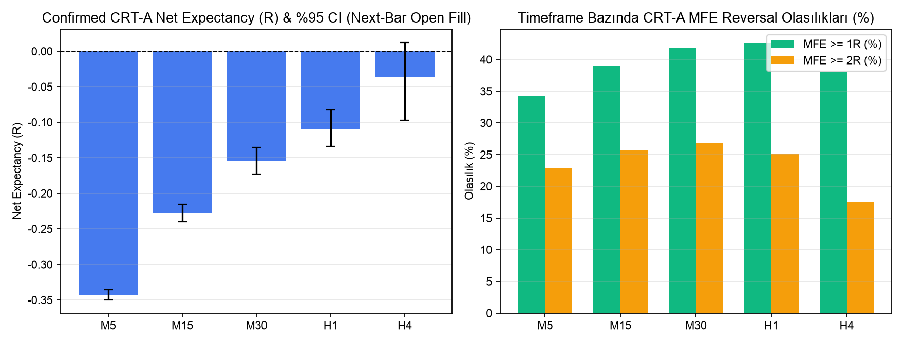
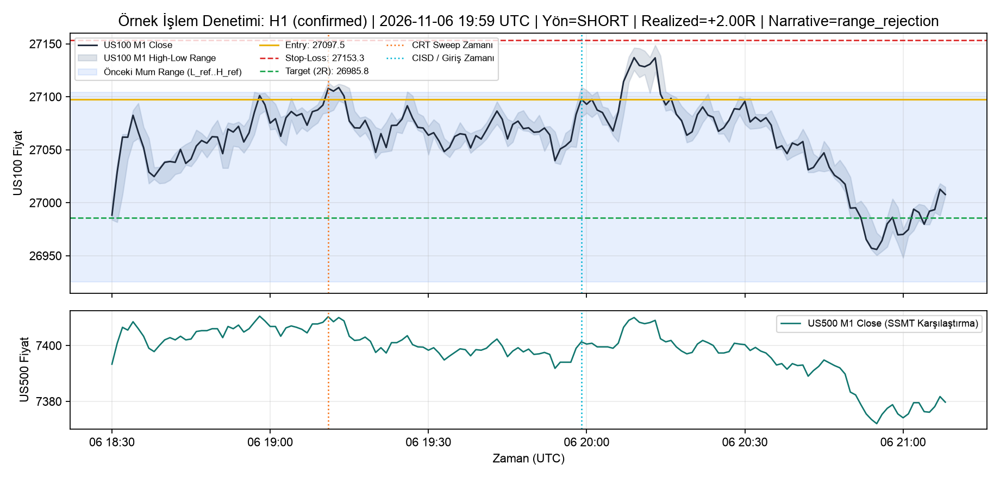

# ASTRA 6 V3 FINAL — Universal Fractal Market Narrative & Hardware-Optimized Quant Lab

Gerçek tarihsel **US100, US500 ve US30** CFD kotasyonları (`7 Kasım 2021 – 7 Kasım 2026`, `1,677,731` hizalanmış M1 bar ve `6,063,038` Dukascopy 30-saniyelik bar) üzerinde **Quarterly Theory (6H / 90M / 22.5M) × MMXM (13 Aşama + Failed/Invalidated) × Original Consolidation × Candle Range Theory (CRT-A..L) × Sequential SMT (SSMT) × Çoklu-Timeframe CISD × ICT Likidite Süpürmeleri × Çapraz-Timeframe Hedef Seçimi (`LTF->HTF`, `HTF->LTF`, `Same-TF`)** kombinasyonlarını hem **LONG**, hem **SHORT**, hem **COMBINED** yönlerde kesin nedensellik (*strict causality / zero look-ahead*) ilkesiyle test eden kantitatif araştırma sistemi.

---

## 📄 Araştırma Raporları (V3 + V2)

- 📕 **V3 Universal Fractal PDF Raporu:** [`reports/ASTRA6_V3_Universal_Fractal_Raporu.pdf`](reports/ASTRA6_V3_Universal_Fractal_Raporu.pdf)
- 🌐 **V3 Universal Fractal HTML Raporu:** [`reports/ASTRA6_V3_Universal_Fractal_Raporu.html`](reports/ASTRA6_V3_Universal_Fractal_Raporu.html)
- 📕 **V2 Doğrulama & Araştırma PDF Raporu:** [`reports/ASTRA6_Arastirma_Raporu.pdf`](reports/ASTRA6_Arastirma_Raporu.pdf)
- 🌐 **V2 Doğrulama & Araştırma HTML Raporu:** [`reports/ASTRA6_Arastirma_Raporu.html`](reports/ASTRA6_Arastirma_Raporu.html)
- 🗄️ **DuckDB & 28+ Zorunlu V3 Parquet Veri Küpü:** [`data/results/astra6_v3.duckdb`](data/results/astra6_v3.duckdb) ve [`data/results/`](data/results/)

---

## 📈 V3 & V2 Temel Görsel Bulgular

### V3.1 — 64 İkili Faktör Kombinasyonu (`LONG` vs `SHORT` vs `BOTH`)


### V3.2 — Çapraz-Timeframe Hedef Hiyerarşisi (`LTF->HTF`, `HTF->LTF`, `Same-TF`)


### V3.3 — 13-Aşamalı MMXM × Quarterly Theory (`Q1..Q4`) Etkileşim Matrisi


### V3.4 — Macro 90M × Micro 22.5M SSMT 10 Durum & Tam Ablasyon Analizi


### V3.5 — 24-Saatlik & Nasdaq `09:30` 5-Dakikalık `LONG` vs `SHORT` Profili


### V2 — CRT Timeframe Expectancy & Örnek İşlem Denetimi



---

## 🚀 Kurulum ve Çalıştırma

```bash
# 1. Bağımlılıkları kurun (uv ile)
uv sync

# 2. (İlk kurulumda) 5-yıllık tarihsel CFD veri ambarını indirin ve oluşturun (~532 MB)
uv run python run_pipeline.py --ingest

# 3. Tek komutla V2+V3 doğrulama, rapor üretimi ve 2,612 QA/DST testini çalıştırın
uv run python run_pipeline.py

# 4. Sadece V3 Universal Fractal Engine'i yeniden hesaplamak için
uv run python run_pipeline.py --v3

# 5. Tüm 5-yıllık V2 + V3 araştırma motorunu sıfırdan hesaplamak için
uv run python run_pipeline.py --full

# 6. V3 Modül A–L + V2 Panel 0–12 İnteraktif Streamlit + Plotly Dashboard'u başlatın
uv run streamlit run app.py
```

---

## 🧪 Otomatik QA & DST Doğrulama Paketi (`2,612 / 2,612 PASSED`)

```bash
uv run pytest -q
```
- `tests/test_clock_dst.py`: `zoneinfo` (IANA tzdb) tabanlı `2,563` çok-yıllı ABD/İngiltere DST geçiş ve oturum saati testi.
- `tests/test_qa_suite.py`: V2 Test A – Test L (Look-ahead yasağı, mum kapanışı kuralı, 3-endeks SSMT simetrisi, kötümser SL/TP muhasebesi, tekrar üretilebilirlik).
- `tests/test_v3_fractal_qa.py`: V3 Bölüm 21 QA paketi (28 zorunlu Parquet tablosu, 64 ikili kombinasyon × LONG/SHORT/BOTH, 15 strateji ailesi altkümesi, 13-aşamalı MMXM + OC kronolojisi, `LTF->HTF` ve `HTF->LTF` çapraz hedef bağımsızlığı, saf Python vs Numba JIT kernel birebir eşleşme testi, 25 sıralama ve `10x100` doğrulama örneği).
