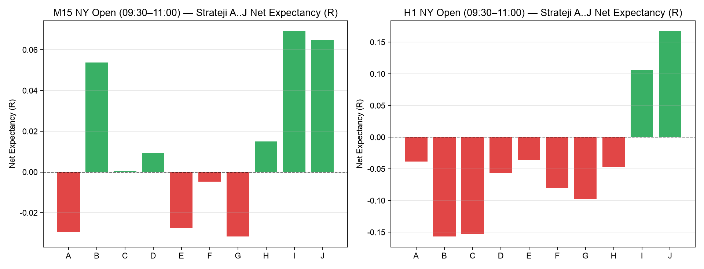
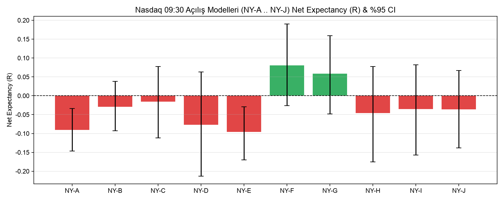
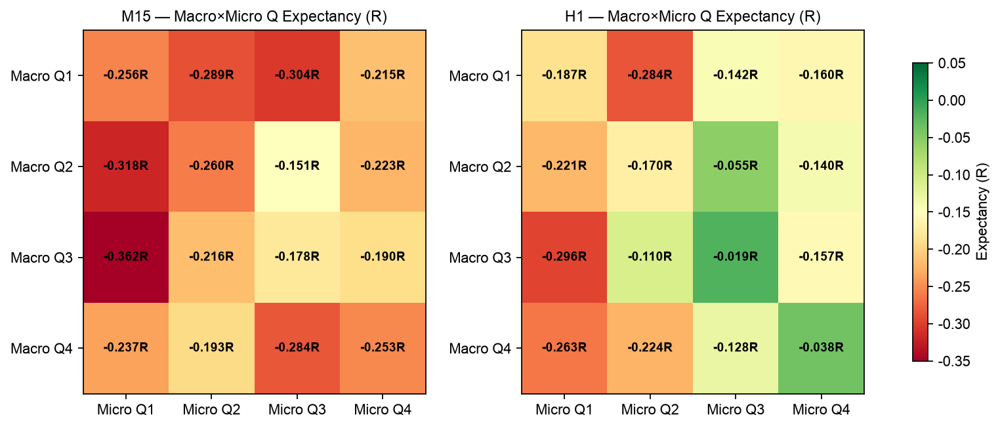
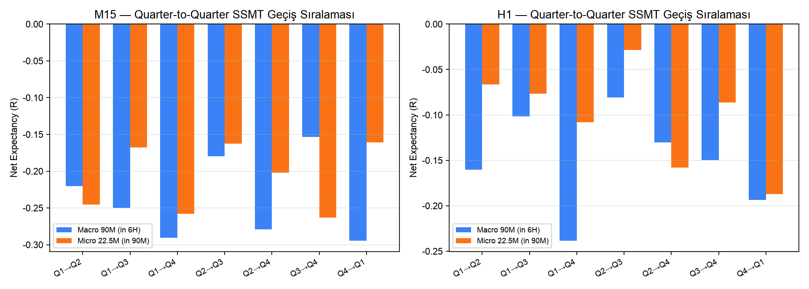
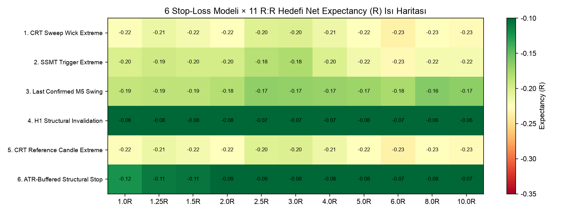
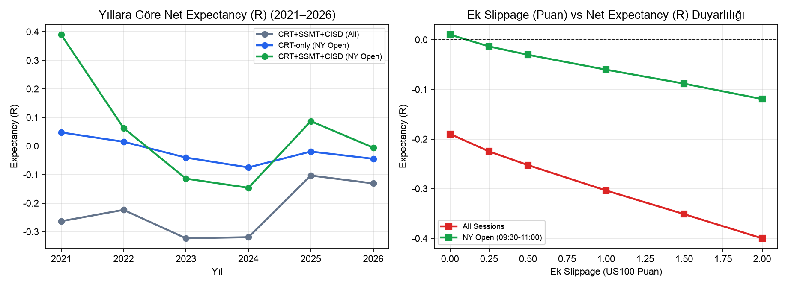

# ASTRA 6 — Fractal QT + ICT + MMXM + CRT + SSMT + CISD Quantitative Research Lab

Gerçek tarihsel **US100, US500 ve US30** CFD kotasyonları (`7 Kasım 2021 – 7 Kasım 2026`, `1,677,731` hizalanmış M1 bar ve `6,063,038` Dukascopy 30-saniyelik bar) üzerinde **Quarterly Theory (6H / 90M / 22.5M) + Candle Range Theory (CRT-A..L) + Sequential SMT (SSMT) + CISD + ICT Likidite Süpürmeleri + MMXM + HTF Narrative** kombinasyonlarını kesin nedensellik (*strict causality / zero look-ahead*) ilkesiyle test eden kantitatif araştırma sistemi.

---

## 📄 Araştırma Raporları

- 📕 **PDF Araştırma Raporu (10 Sayfa, Grafik & Tablolu):** [`reports/ASTRA6_Arastirma_Raporu.pdf`](reports/ASTRA6_Arastirma_Raporu.pdf)
- 🌐 **HTML Araştırma Raporu (Tam Tablolu):** [`reports/ASTRA6_Arastirma_Raporu.html`](reports/ASTRA6_Arastirma_Raporu.html)
- 📊 **26 Sonuç Tablosu (Parquet & JSON):** [`data/results/`](data/results/)

---

## 📈 Temel Görsel Bulgular

### 1. CRT Timeframe Bazında Net Expectancy (R) ve MFE Reversal Olasılıkları


### 2. Nasdaq NY Open (`09:30–11:00`) Baseline Stratejileri (`A..J`)


### 3. Nasdaq 09:30 Açılış Modelleri (`NY-A .. NY-J`)


### 4. Quarterly Theory `Macro Q(1..4) × Micro Q(1..4)` Isı Haritası


### 5. Quarter-to-Quarter (`Q1→Q2 .. Prev Q4→Curr Q1`) SSMT Geçiş Sıralaması


### 6. 5 Yapısal Stop-Loss Modeli × 11 R:R Hedefi Isı Haritası


### 7. Yıllara Göre Performans (`2021–2026`) ve Slippage Duyarlılığı


### 8. Örnek İşlem Denetimi (Full Trade Replay: US100 CRT + US500 SSMT + CISD)


---

## 🚀 Kurulum ve Çalıştırma

```bash
# 1. Bağımlılıkları kurun (uv ile)
uv sync

# 2. (İlk kurulumda) 5-yıllık tarihsel CFD veri ambarını indirin ve oluşturun (~532 MB)
uv run python run_pipeline.py --ingest

# 3. Tek komutla doğrulama, rapor üretimi ve 2,573 QA/DST testini çalıştırın
uv run python run_pipeline.py

# 4. Tüm 5-yıllık araştırma motorunu baştan hesaplamak için
uv run python run_pipeline.py --full

# 5. 12 Panelli İnteraktif Streamlit + Plotly Dashboard'u başlatın
uv run streamlit run app.py
```

---

## 🧪 Otomatik QA & DST Doğrulama Paketi (`2,573 / 2,573 PASSED`)

```bash
uv run pytest -q
```
- `tests/test_clock_dst.py`: `zoneinfo` (IANA tzdb) tabanlı `2,563` çok-yıllı ABD/İngiltere DST geçiş ve oturum saati testi.
- `tests/test_qa_suite.py`: Test A – Test L (Look-ahead yasağı, mum kapanışı kuralı, 3-endeks SSMT simetrisi, kötümser SL/TP muhasebesi, tekrar üretilebilirlik).
