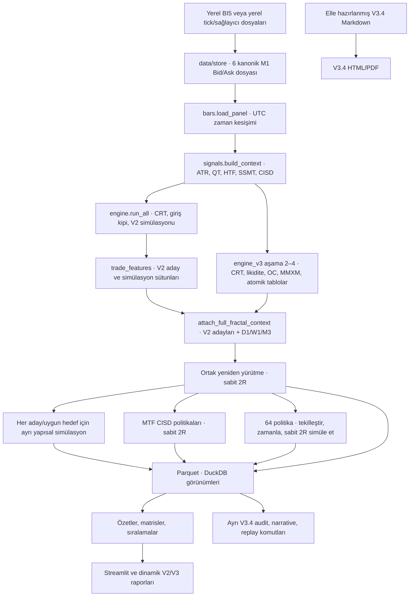

# ASTRA 6 kaynak mimarisi

**Denetlenen kaynak** `main` · `9274803d002a14bc18e0a918d8a90fd615b0ed8f` · 9 Kasım 2026  
**Aşama 1–2 kontrol noktası** Sürüm, yerel veri, çalışma girişleri, tablo üreticileri ve tüketicileri eşleştirildi.

## Gerçek çağrı yolları

| Geçiş | Kod ve fiilî sözleşme |
|---|---|
| BI5 → M1 | [`decode_candles`](../astra6/data/dukascopy.py#L58) LZMA + big-endian kayıtları UTC gün başlangıcı ve ofsetle açar. [`build_symbol_minutes`](../astra6/bars.py#L57) günlük dosyaları birleştirir. [`write_store`](../astra6/bars.py#L72) bu alternatif depolama yoludur. |
| Tick/OANDA → kullanılan birleşik store | [`_process_duka_part`](../astra6/data/ingest_hf.py#L63) tick'leri M1/30s Bid/Ask OHLC'ye toplar. [`_fetch_oanda_month`](../astra6/data/ingest_hf.py#L174) aylık fiyatı normalize eder. [`build_unified_stores`](../astra6/data/ingest_hf.py#L226) DUKA ve OANDA kuyruğunu birleştirip altı kanonik dosyaya ayırır. İndirme/üretme yolları bu denetimde çalıştırılmadı. |
| Store → panel → takvim | [`load_m1`](../astra6/bars.py#L81) ve [`load_panel`](../astra6/bars.py#L85) altı dosyanın `ts` kesişimini alır. [`clock`](../astra6/clock.py#L28) IANA saat dilimleriyle seans referanslarını kurar. [`resample`](../astra6/bars.py#L153) yalnız Bid'i zaman kovalarına böler. [`quarter_labels`](../astra6/bars.py#L184) yerel duvar saati üzerinden QT etiketlerini üretir. |
| Panel → yapı ve likidite | [`build_context`](../astra6/signals.py#L28) ATR, swing, önceki dönem seviyeleri, saat bağlamı ve olay tablolarını üretir. [`swing_table`](../astra6/ict.py#L57) pivotu sağ bar kapandığında yayınlar. [`build_liquidity_events_table`](../astra6/fractal_v3.py#L878) Takvim anchor’lı CRT kayıtlarından beş sınıfta olay/etiket çıkarır. Opening-range bağlamı adaylara ayrı eklenir. Bu tablo 64 politika döngüsünün fırsat beslemesi değildir. |
| CRT ve standart SMT | [`extract_crt_events`](../astra6/signals.py#L134) referans mum ve M1 sınırlarını [`scan_crt`](../astra6/crt.py#L63) çekirdeğine verir. [`classify_confirmed`](../astra6/crt.py#L212) CRT varyantları. [`materialize_entries`](../astra6/signals.py#L219) tetik barı, standart SMT, dönem seviyeleri, MTF CISD ve V2 MMXM bağlamı üretir. |
| SSMT, bağımsız CISD | [`ssmt_events`](../astra6/smt.py#L102) önceki QT blokları ve anlık ekstrem farklarını işler. [`attach_ssmt`](../astra6/smt.py#L187) temel sinyal anındaki etkin olayları bağlar. [`extract_tf_cisd_events`](../astra6/cisd.py#L162) yedi ayrı seride kapanış olayları oluşturur. [`attach_true_cisd_to_signals`](../astra6/cisd.py#L280) geçmiş aktif ve ileri onay eşlemelerini ayrı sütunlara yazar. M1 ileri eşlemesine CRT kökenli CISD de girebilir. |
| OC → V3 MMXM | [`extract_original_consolidations`](../astra6/fractal_v3.py#L222) ve [`_scan_original_consolidations_numba`](../astra6/fractal_v3.py#L116) dar bant + ayrılış üretir. [`build_fractal_mmxm_state_events`](../astra6/fractal_v3.py#L786) her doğrulanmış OC için M1 tabanlı [FSM](../astra6/fractal_v3.py#L346) çağırır. FSM'e CRT, SMT, SSMT, QT veya CISD tablosu girmez. V2 [`build_mmxm_table`](../astra6/mmxm.py#L84) ve [`attach_mmxm_to_signals`](../astra6/mmxm.py#L107) ayrı proxy'dir. |
| Olaylar → araştırma fırsatı | [`engine.run_all`](../astra6/engine.py#L237) CRT'den üretilen adayları [`_sim_df`](../astra6/engine.py#L31) üzerinden [`sim_batch`](../astra6/sim.py#L34) ile yürütür. [V3 hazırlığı](../astra6/engine_v3.py#L583) V2 işlem özelliklerini okur, D1/W1 ve adımlı M3 adayları ekler. [`attach_full_fractal_context`](../astra6/fractal_v3.py#L1191) bu satırlara ID, bias, OC, MMXM ve TF etiketleri bağlar. [`build_atomic_events_database`](../astra6/fractal_v3.py#L981) likidite, ana çift NY18 SSMT, CISD, OC ve MMXM kayıtlarını arşivler. CRT ve alternatif SSMT anchor tabloları ayrıdır. Atomik tablodaki her olay fırsata dönüşmez. |
| Ortak aday yürütmesi | [`run_v3_pipeline`](../astra6/engine_v3.py#L632) en geç CRT/reclaim/CISD/MMXM indeksini hesaplayıp [`execute_strategy_at_custom_triggers`](../astra6/fractal_v3.py#L1705) ile 2R simüle eder. Bu aşama `all_trades`, LONG/SHORT bölümleri, 15 aile filtresi ve birçok matrisi besler. |
| Yapısal hedef dalı | [`build_cross_timeframe_targets_and_outcomes`](../astra6/fractal_v3.py#L1448) uygun olan her aday-hedef çiftini [`fast_target_exec_full_numba`](../astra6/hpc.py#L340) ile simüle eder. M5 kaynağı her dördüncü satıra örneklenir. [`build_narrative_graph_and_snapshots`](../astra6/fractal_v3.py#L1814) ön/son tabloları ve üç etiket kenarı üretir. Bu grafik 64 stratejiyi tetiklemez. [`all_trades`](../astra6/engine_v3.py#L744) hedef etiketi alsa da ortak 2R fiyat ve sonucu yazar. |
| 64 ayrı politika | [`run_v3_pipeline` 828–1103](../astra6/engine_v3.py#L828) ilk `UEV` satırını seçer, 6 bitin maskesini uygular, politika tetik/dolum/stop/2R hesaplar, LONG Bid ve SHORT Ask ile Numba çağırır. Politika tablosu ve konfigürasyon/scope/yön özetleri ayrıdır. |
| MTF CISD deneyleri | [`run_v3_pipeline` 1433–1566](../astra6/engine_v3.py#L1433) UEV'yi yeniden tekilleştirir, 20 etiketli senaryoda ayrı tetik ve 2R simülasyonu çalıştırır. `j_exit` kalıtımı hatalıdır. `00_No_CISD` ve unconstrained etiketleri aynı maskeyi ve tetiği tekrarlar. |
| Araştırma çıktıları | [`_fast_cell_metrics`](../astra6/engine_v3.py#L89) ve [`_day_cluster_stats_and_bootstrap_numba`](../astra6/hpc.py#L537) özet/inferans, [`_select_genuine_25_rankings`](../astra6/engine_v3.py#L266) sıralama, [son aşama](../astra6/engine_v3.py#L1943) ilk 10 araştırma satırı ve mutlak Parquet yollarına DuckDB görünümleri yazar. Sonradan eklenen V3.4 tabloları yerel katalogda da görünür. |
| Gösterim ve yayımlama | [`app.load_table`](../app.py#L45) Parquet, [`load_json`](../app.py#L51) JSON, [`load_m1_slice`](../app.py#L57) yerel Bid M1 okur. V3/V2 sekmeleri tablolara Plotly ve Streamlit görünümü verir. [`report.build_all_reports`](../astra6/report.py#L868) V2 ve [`report_v3.build_v3_reports`](../astra6/report_v3.py#L300) V3 çıktılarıdır. |
| V3.4 yayın zinciri | [`run_audit`](../astra6/audit_v34_models.py#L109) ve [`run_narrative_validation`](../astra6/fractal_narrative_v34.py#L38) hazır işlem sonuçlarını filtreler ve özetler. [`build_trade_replays`](../astra6/trade_replay_v34.py#L118) farklı bir seçim yapar ve illüstrasyon çizer. [`build_v34_report.build`](../build_v34_report.py#L267) mevcut Markdown'ı Pandoc/Chrome ile HTML/PDF'ye çevirir. JSON veya Parquet rapor metninin doğrudan girdisi değildir. |

## Çalıştırma ve sürüm sınırları

- [`run_pipeline.main`](../run_pipeline.py#L131) eksik depo ve açık `--ingest` ile ağ indirme/yeniden inşa yolu açar. Mevcut store ile V2/V3 varlık kontrolleri, V2 denetimi, V3 motoru, V2/V3 raporları, pytest ve tam SHA manifesti çalıştırabilir. V3.4 model, narrative, replay ve final rapor komutlarını zincire katmaz. Bu nedenle audit sırasında çağrılmadı.
- [`engine_v3.run_v3_pipeline`](../astra6/engine_v3.py#L404) faz başında donanım benchmark'ı çalıştırır. Faz 2–4 atomik gölü kısmi store özeti, algoritma sabiti ve config hash ile yeniden kullanabilir. Faz 5 ve sonrası yeniden üretilir. Faz-2–4 çıktıları için içerik hash'i kontrolü yoktur. [`CheckpointManager.is_cache_valid`](../astra6/hpc.py#L890)
- Yerel DuckDB salt okunur açıldı. `duckdb_views()` tanımları `/Users/mangtay/qt_test/data/results/…` biçimindedir. Başka checkout'ta aynı verinin varlığı DuckDB görünümlerinin taşınabilirliğini sağlamaz. Parquet dosyaları doğrudan sorgulanabilir. [Görünüm üreticisi](../astra6/engine_v3.py#L1976)
- [`pyproject.toml`](../pyproject.toml) paket komutunu `astra6:main` olarak tanımlar. [`src/astra6/__init__.py`](../src/astra6/__init__.py#L1) yalnız selamlama yazar. Araştırma kodu kökteki `astra6/` ağacında çalışır. Checkout ile kurulu giriş noktasını ayrı doğrulamak gerekir.
- Ham depoyu okuyan modüller `bars`, `forensics`, `ingest_hf` ve bazı rapor/UI örneklem yollarıdır. Çekirdek bağımlılıkları Pandas/NumPy, Polars/PyArrow, Numba, SciPy/statsmodels, DuckDB ve IANA timezone verisidir. `exchange_calendars` referans takvimi çıkarır. Üretim adayları doğrudan borsa takviminden elenmez.
