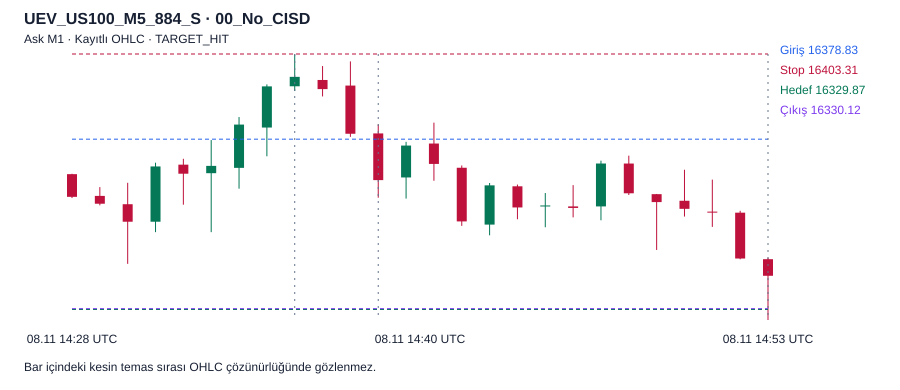

# ASTRA 6 V3.5 onarım ve doğrulama raporu

**Durum `NOT_VERIFIED`.** Davranışsal örnek tamamlandı. Tam tarihsel P0 kapısı açık.

V3.4 denetimi stop ve hedef sızıntısını, geriye yazılan MMXM aşamalarını, emir zaman alanlarındaki tutarsızlığı ve sentetik replay yolunu kanıtladı. V3.5, ayrı kayıtlı olay ve fiyat kanıtı kullanan bir emir motoru ekliyor.

| Davranışsal örnek | Sayı |
| --- | --- |
| M1 gözlemi | 1300 |
| Benzersiz UEV | 499 |
| Politika ve prob | 75 |
| Politika–fırsat satırı | 36443 |
| Dolum | 3381 |
| Dolum öncesi geçersizleşme | 29546 |
| Diğer iptal | 3516 |
| Kayıtlı fiyat replay'i | 20 |

## Emir zamanlaması

| Politika | Onay | Dolum | Çıkış | Giriş | Stop | Hedef | Çıkış kotasyonu | Net R |
| --- | --- | --- | --- | --- | --- | --- | --- | --- |
| 00_No_CISD | 887 | 888 | 902 | 16378.829 | 16403.309 | 16329.869 | 16329.869 | +1.989788 |
| 01_M1_CRT_CISD | 888 | 889 | 1249 | 16366.129 | 16403.309 | 16291.769 | 16351.131 | +0.396665 |
| M1_STANDALONE_CISD | 901 | 902 | 1262 | 16342.827 | 16403.309 | 16221.863 | 16343.231 | -0.010813 |
| M5_STANDALONE_CISD | 903 | 904 | 1264 | 16341.469 | 16403.309 | 16217.789 | 16343.741 | -0.040783 |
| M15_STANDALONE_CISD | 908 | 909 | 1269 | 16346.239 | 16403.309 | 16232.099 | 16331.751 | +0.249483 |

Beş politika aynı gerçek SHORT olayında bağımsız Ask fiyat yoluyla eşleşti. CRT içi M1 ve bağımsız M1 farklı teyitlerdir. Bu tek örnek zaman dilimlerinin genel üstünlüğünü ölçmez.

## Dört model ve yayın kapısı

| V3.4 kaynak grubu | Önceki N | Önceki ort. R | V3.5 tarihsel sonuç |
| --- | --- | --- | --- |
| MODEL_1_H1_M5_M15_LIQ | 325 | +0.82789 | Hesaplanmadı |
| MODEL_2_H1_REV_M5_OC | 792 | +0.18931 | Hesaplanmadı |
| MODEL_3_NY_OPEN_CFG64_57 | 658 | +0.07152 | Hesaplanmadı |
| MODEL_4_MMXM_COMPLETED_QT_Q2_LONG | 96803 | -0.18079 | Hesaplanmadı |

Model 1'in 200 ve Model 2'nin 18 geç hedefi V3.4 bulgularıdır. V3.5 karar anındaki teyitli, geçerli ve tüketilmemiş seviyeyi arar. İki gerçek karşı örnek ayrı yeniden yürütüldü. Tam model popülasyonları, üstün hedef tipi veya doğrulanmış MMXM × QT anlatısı henüz belirlenmedi.

| US100 | Tam | Sınıflandırılamayan kısmi | Açık |
| --- | --- | --- | --- |
| H4 | 3814 | 3881 | 1 |
| D1 | 0 | 1290 | 1 |
| W1 | 0 | 260 | 1 |

Tarihli broker seans takvimi eksik. İki araçta gerçek 30 saniyelik kotasyonların ortak kapsamı en geç 2026-05-22 20:14:30 UTC'de biter. Bağımsız H1 dönüş ve bağlı MMXM/OC kuralları tam tarih için doğrulanmadı. Beş yıllık çalışma başlatılmadı. Sıralama ve yeni finansal sonuç yayımlanmadı.

## Kayıtlı kotasyon

Bar içindeki kesin temas sırası M1 OHLC'den bilinemez. Grafik ve tablo, aynı örnek emir defteri ve replay JSON'una bağlıdır.

| Replay | Olay | Politika | Dolum / çıkış | Durum |
| --- | --- | --- | --- | --- |
| [01](figures/v35_replays/replay_01.svg) | UEV_US100_M5_884_S | 00_No_CISD | 888 / 902 | TARGET_HIT |
| [02](figures/v35_replays/replay_02.svg) | UEV_US100_M3_18_L | CFG64_00 | 19 / 35 | TARGET_HIT |
| [03](figures/v35_replays/replay_03.svg) | UEV_US100_M3_47_S | CFG64_00 | 50 / 54 | TARGET_HIT |
| [04](figures/v35_replays/replay_04.svg) | UEV_US100_M30_30_S | CFG64_00 | 52 / 170 | TARGET_HIT |
| [05](figures/v35_replays/replay_05.svg) | UEV_US100_M3_95_S | CFG64_00 | 97 / 107 | TARGET_HIT |
| [06](figures/v35_replays/replay_06.svg) | UEV_US100_M5_109_L | CFG64_00 | 110 / 158 | TARGET_HIT |
| [07](figures/v35_replays/replay_07.svg) | UEV_US100_M5_228_L | CFG64_00 | 229 / 370 | TARGET_HIT |
| [08](figures/v35_replays/replay_08.svg) | UEV_US100_M5_10_S | CFG64_00 | 15 / 20 | STOP_HIT |
| [09](figures/v35_replays/replay_09.svg) | UEV_US100_M15_15_S | CFG64_00 | 23 / 23 | STOP_HIT |
| [10](figures/v35_replays/replay_10.svg) | UEV_US100_M3_21_S | CFG64_00 | 23 / 23 | STOP_HIT |
| [11](figures/v35_replays/replay_11.svg) | UEV_US100_M5_40_S | CFG64_00 | 43 / 43 | STOP_HIT |
| [12](figures/v35_replays/replay_12.svg) | UEV_US100_M15_44_S | CFG64_00 | 48 / 48 | STOP_HIT |
| [13](figures/v35_replays/replay_13.svg) | UEV_US100_M5_44_S | CFG64_00 | 48 / 48 | STOP_HIT |
| [14](figures/v35_replays/replay_14.svg) | UEV_US100_H1_1269_L | CFG64_00 | 1270 / 1299 | DATA_END |
| [15](figures/v35_replays/replay_15.svg) | UEV_US100_M15_1269_L | CFG64_00 | 1270 / 1299 | DATA_END |
| [16](figures/v35_replays/replay_16.svg) | UEV_US100_M30_1269_L | CFG64_00 | 1270 / 1299 | DATA_END |
| [17](figures/v35_replays/replay_17.svg) | UEV_US100_M3_1293_S | CFG64_00 | 1294 / 1299 | DATA_END |
| [18](figures/v35_replays/replay_18.svg) | UEV_US100_M5_1293_S | CFG64_00 | 1294 / 1299 | DATA_END |
| [19](figures/v35_replays/replay_19.svg) | UEV_US100_M3_53_L | CFG64_00 | 56 / 63 | STOP_HIT |
| [20](figures/v35_replays/replay_20.svg) | UEV_US100_M5_54_L | CFG64_00 | 56 / 63 | STOP_HIT |

## Paper trading öncesi

Kapsam dışı seans ve TF'leri sabitle, H1 dönüş ve OC ilişkisini bağımsız olaylarla bağla, geniş P0 testini geçir. Düzeltilmiş tarihsel işlemler ve portföy sonuçları ayrı hesaplanmalı. İleri paper emirleri dondurulmuş politika kimliğiyle kaydedilmeli.

[Onarım](ASTRA6_V35_CAUSAL_REPAIR_AUDIT.md) · [Önce/sonra](ASTRA6_V35_BEFORE_AFTER_RESULTS.md) · [MMXM × QT](ASTRA6_V35_MMXM_QT_VALIDATION.md) · [Emir QA](ASTRA6_V35_INDEPENDENT_EXECUTION_QA.md) · [İstatistik](ASTRA6_V35_STATISTICAL_VALIDATION.md) · [Testler](ASTRA6_V35_TEST_RESULTS.md)
