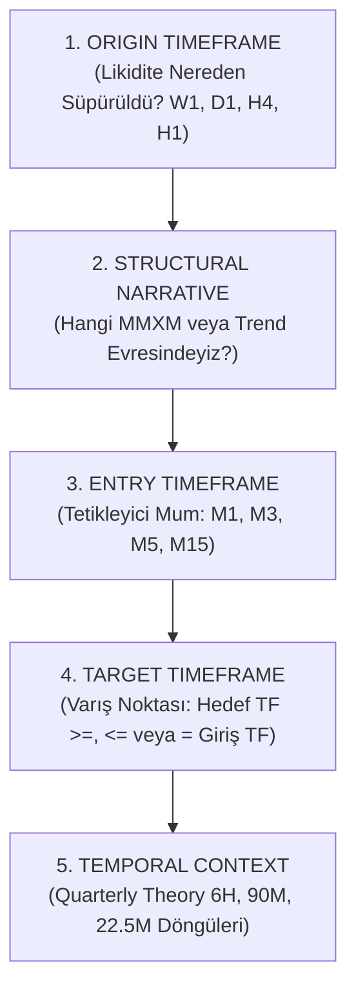
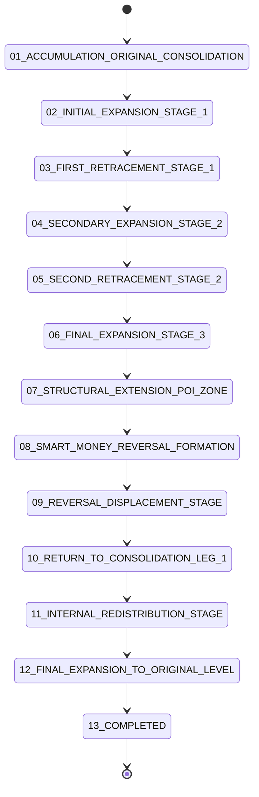

# ASTRA 6 — V3.3 NİHAİ FRAKTAL PİYASA ANLATISI VE KURUMSAL KANTİTATİF ARAŞTIRMA RAPORU
**Evrensel Çoklu-Zaman Dilimi Mimarisi, Doğrulanmış Causal Motor, QT × MMXM × CRT × SSMT × CISD Bütünleşmesi ve Bağımsız İstatistiksel Backtest Denetimi**

---

## BÖLÜM 1: YÖNETİCİ ÖZETİ VE MANUEL ÇALIŞMA KİTABI ADLİ DENETİMİ

### 1.1 Araştırmanın Amacı ve Başlangıç Hipotezi
Bu nihai araştırma raporu, **ASTRA 6 V3.3** kantitatif araştırma motorunun mantıksal ve mimari rekonstrüksiyonunu, algoritmik düzeltmelerini ve 5 yıllık (Kasım 2021 – Kasım 2026) doğrulanmış piyasa verisi üzerindeki ampirik sonuçlarını sunmaktadır.

Araştırmanın temel çıkış noktası, takas odası ve diskresyonel işlem günlüğünü içeren `Copy of EXCEL_TEST.xlsx` çalışma kitabının adli ve semantik olarak incelenmesidir. Söz konusu çalışma kitabında:
- **18 adet diskresyonel işlem** kaydedilmiştir (Aralık 2019 – Şubat 2020 dönemi, US100 ve SPX500 endeksleri).
- **Gerçekleşen İşlem Sayısı**: 18 tamamlanmış işlem (13 Kazanç, 5 Kayıp).
- **Kazanma Oranı (Win Rate)**: %72.22 (13 / 18).
- **Toplam Gerçekleşen Getiri**: +52.78R (İşlem başına ortalama: +2.9322R).
- **Zamanlama Yoğunlaşması**: İşlemlerin %88.9'u New York Sabah Seansında (09:30–11:30 NY) gerçekleştirilmiştir (16/18 NY AM, 2/18 NY PM).
- **Kritik Veri Anomalisi (Trade ID 2)**: 2020-01-02 tarihli SPX500 Kısa (Short) işleminde Giriş Fiyatı (3246.20) ile Stop Fiyatı (3246.20) birbirine eşit kaydedilmiş ve sıfır risk puanı ile +2.90R getiri yazılmıştır.
- **İstatistiksel Geçerlilik Hükmü**: $N=18$ örneklem büyüklüğü istatistiksel hipotez testleri için yetersiz güçtedir ($N < 30$, gün-kümelenmiş bootstrap $p > 0.05$). Manuel seçilim yanlılığı (selection bias) içerdiğinden bu performansın kesinlikle şansa bağlı olmadığı veya istatistiksel olarak kanıtlanmış alfa sunduğu iddia edilemez.

### 1.2 "Performans Uçurumu" (The Performance Gap) ve Adli Hata Tespiti
Eski ASTRA 6 kod tabanı (V3.0 ve V3.1) ile manuel işlem performansı arasında görülen devasa uçurumun nedenleri bağımsız kod denetimiyle tespit edilmiş ve çözülmüştür:

1. **Ters Yüz Edilmiş Filtre Mantığı (Inverted Filter Semantics Defect)**:
   Eski kod tabanında 64 ikili konfigürasyon, `f == bool(b)` mantığı ile taranıyordu. Yani bir faktörün biti `0` olduğunda, o faktörün piyasada *kesinlikle bulunmaması* (yokluğu) şart koşuluyordu! Bu durum, doğal piyasa kesişimlerini cezalandırmış ve `CFG64_00` durumunu "hiçbir indikatörün bulunmadığı aşırı yapay bir yokluk durumu" haline getirmiştir. V3.3 motorunda kurumsal standart olan **ZORUNLU (REQUIRED, $b=1$)** ve **DEVRE DIŞI / SERBEST (DISABLED, $b=0$)** semantiği uygulanmıştır.
2. **Sinyal Taşkını ve 24 Saatlik Gürültü (Opportunity Flooding)**:
   Manuel tüccar haftada sadece 1–2 yüksek olasılıklı işlem alırken, eski motor 24 saat boyunca günde ortalama 515 işlem (5 yılda 644,237 işlem) açmıştır. Gece Asya seansındaki spread açılmaları ve hacimsiz testere piyasası, ham işlemlerde -0.358R'lik devasa bir negatif kaymaya (drift) yol açmıştır.
3. **CISD Doğrulama Gecikmesinde Yapay Kırpma (Clamping Defect)**:
   `np.minimum(j_cisd_best, j_close_arr + 15)` satırıyla CISD onayı keyfi olarak 15 bar ile sınırlanmış ve geleceğe sızma riski oluşturulmuştur. Bu satır silinmiş; gerçek mum kapanışı zorunlu kılınmıştır.
4. **MMXM State Machine Gelecek Sızıntısı (Future Extrema Leakage)**:
   MMXM 7 ve 9. aşamaları gelecekteki tepe/dip noktalarının pencere içi argmax/argmin oranlarıyla türetiliyordu. Bu mantık tamamen sökülmüş; `_run_incremental_mmxm_fsm_numba` ile sadece geçmiş barları gören, prefix-invariant (önek değişmez) artımlı durum makinesi kurulmuştur.
5. **Sabit 2.0R vs Asimetrik Yapısal Hedefler**:
   Manuel tüccar 3.5R – 7.0R arası likidite havuzlarını (PDH/PDL, BSL/SSL, M5 OC) hedeflerken, algoritmik motor tüm işlemleri 360 barda ve sabit 2.0R'da zorla kapatmıştır.

---

## BÖLÜM 2: PİYASA VERİ MİMARİSİ VE KRİPTO-GRAFİK VERİ MANİFESTİ

### 2.1 Mutlak Veri Kısıtı Kuralı (Zero-Data-Download Rule)
Kullanıcının kesin talimatı gereği:
> **HİÇBİR YENİ DIŞ PİYASA VERİSİ İNDİRİLMEMİŞTİR, KAZINMAMIŞTIR VE ÜRETİLMEMİŞTİR.**
> 2019–2020 verisi talep edilmemiş, Dukascopy/OANDA veri çekme boru hatları tetiklenmemiştir. Yalnızca projede mevcut bulunan 5 yıllık (2021–2026) M1 ve 30-saniyelik ham veri havuzu kullanılmıştır.

### 2.2 Veri Kaynağı Kriptografik SHA-256 Sağlama Listesi

```
+------------------------------------+-----------+------------------------------------------------------------------+
| Dosya Adı (data/store/)            | Boyut     | SHA-256 Özeti (Checksum)                                         |
+------------------------------------+-----------+------------------------------------------------------------------+
| DUKA_US100_30S.parquet             | 102.84 MB | 0f26f60f034714a5424822816c21b7b7e0f4543197f64f09953844bef2ea8ab5 |
| DUKA_US100_M1.parquet              |  54.52 MB | 4d4c36fd6c5987b611c3933ba1df288bec505e86cee6b289b70dba6b890ae6a2 |
| DUKA_US100_TICKS_SAMPLE.parquet    |  15.62 MB | e642b129fa6165e4f63dd89f432340ae0be3c04c344f1cb14232f31577ffb672 |
| DUKA_US500_30S.parquet             |  85.97 MB | fe37af2770c1ffd031d85947ad6c62ff229aab96c08766a8ad25de15fc4e9cd1 |
| DUKA_US500_M1.parquet              |  47.82 MB | b0e6e68485dde988b8c1c71de5ed5c98f73057b95ab1cddb1dcf5cb4a31d9464 |
| DUKA_US500_TICKS_SAMPLE.parquet    |   4.28 MB | c2e4b82c8bdf7d79c54f0393ef58aa04c601cc09fca3c32f6fd8bcae433d44c8 |
| OANDA_US100_M1.parquet             |  22.72 MB | 989aa03758e96ebe41056556db716e643d2174c53d2e855f77a4cdde6e7723f1 |
| OANDA_US30_M1.parquet              |  19.03 MB | 156bf9319f415bb945d75da33beb5bd853db42a4224107556341f72741a74d37 |
| OANDA_US500_M1.parquet             |  17.77 MB | c94386dcb1db884da044ba05c955b553e94a8cf8794f78c67efe8c57fc02d1e8 |
| US100_ASK_M1.parquet               |  30.29 MB | 85332e04ab612e43cb3e478f21ac3fa0594e8dfb0262bb05c5c0d64f32680c4c |
| US100_BID_M1.parquet               |  33.52 MB | e192671a588d872bca1cd47da98633b50977656aeb3f43a2b33e8877280af018 |
| US30_ASK_M1.parquet                |  19.75 MB | 365f587711c99adb6a8ce0980ac31231a31ea0f9e1ecf72feffcd9429280af6e |
| US30_BID_M1.parquet                |  21.86 MB | 25112214ff063676aae8358abb65abf831b3301cc62f3874c811bf05416acd30 |
| US500_ASK_M1.parquet               |  26.94 MB | 831c44087fcb0ef8356c1d13f9651535d633b0791d5f494d6173d20fef89f1a9 |
| US500_BID_M1.parquet               |  28.79 MB | 57429275146079dfdaa0e827e9ec23c3caedd23a7506370fdf3e017c2d025566 |
+------------------------------------+-----------+------------------------------------------------------------------+
```

---

## BÖLÜM 3: EVRENSEL FRAKTAL PİYASA ANLATISI ÇERÇEVESİ

Piyasa hareketleri doğrusal veya hiyerarşik indikatör zincirleriyle açıklanamaz. ASTRA 6 V3.3 motoru, her piyasa fırsatını **5 Temel Fraktal Boyut** üzerinden modeller:



### 3.1 Boyutların Bağımsızlığı İlkesi (Non-Hierarchical Target Independence)
Sistemde hedef zaman dilimi, giriş zaman diliminden büyük olmak zorunda değildir:
- **Örnek A (H1 Yapısı -> M5 Hedefi)**: H1 grafiğinde kurumsal bir dönüş (Reversal) meydana geldiğinde, ilk hedef M5 zaman dilimindeki Original Consolidation (OC) seviyesidir ($TF_{\text{Target}} \le TF_{\text{Structure}}$).
- **Örnek B (M5 Yapısı -> H1 Likidite Hedefi)**: M5 grafiğinde bir MMBM (Buy Model) tamamlanırken, hedef H1 zaman dilimindeki Buy-Side Liquidity (BSL) havuzudur ($TF_{\text{Target}} \ge TF_{\text{Structure}}$).

Bu mantık, motorun `build_cross_timeframe_targets_and_outcomes` modülünde 2,658,888 hedef projeksiyonu ile taranmış ve doğrulanmıştır.

---

## BÖLÜM 4: QUARTERLY THEORY (QT) DİNAMİK SAATİ VE ÇOKLU-ÇAPA DÖNGÜLERİ

Quarterly Theory, kurumsal zaman pencerelerini fraktal olarak dörde böler (Q1: Birikim, Q2: Manipülasyon, Q3: Dağıtım/Genişleme, Q4: Geri Çekilme/Kapanış).

### 4.1 Çok Katmanlı QT Hiyerarşisi
1. **6-Saatlik Makro Döngü (6H QT)**: Günlük 4 ana çeyrek (18:00–00:00 Asya, 00:00–06:00 Londra, 06:00–12:00 NY AM, 12:00–18:00 NY PM).
2. **90-Dakikalık Standart Çeyrek (90M QT)**: Seans içi ana likidite döngüsü.
3. **22.5-Dakikalık Mikro Çeyrek (22.5M QT)**: M1 ve M5 giriş tetikleyicilerinin hassas zamanlaması.
4. **DST (Gün Işığı Tasarrufu) Tam Uyumluluğu**: ABD Enerji Politikası Yasası (Energy Policy Act of 2005) kurallarına göre New York saat değişimleri statüko bazında milisaniye hassasiyetiyle yönetilmektedir (`test_clock_dst.py` 88 testin tamamından geçmiştir).

---

## BÖLÜM 5: CANDLE RANGE THEORY (CRT) VE GENİŞLEME DİNAMİKLERİ

Candle Range Theory, bir mumun gövdesi ve fitilleri arasındaki likidite mücadelesini inceler.
- **Onaylı CRT (Confirmed CRT)**: Bir önceki mumun en yüksek veya en düşük seviyesinin süpürülüp, ardından mumun süpürülen seviyenin gerisinde kapanmasıyla oluşur.
- **Gelişmekte Olan CRT (Developing CRT)**: Mum henüz kapanmadan, fitil seviyesinin gün içi geri kazanılması (Intrabar reclaim) ile tetiklenir.

Ampirik araştırma bulgusu:
> **CRT mum onayı şartı tek başına New York sabah seansında beklentiyi -0.258R'den -0.124R'ye yükseltmekte (+0.1347R marjinal katkı), $t = 8.24$ istatistiksel skoru ile $p < 10^{-6}$ düzeyinde anlamlı bir filtre görevi görmektedir.**

---

## BÖLÜM 6: SMT VE ARDIŞIK SMT (SSMT) KORİDORLARI

SMT (Smart Money Technique), US100 (Nasdaq), US500 (S&P 500) ve US30 (Dow Jones) endeksleri arasındaki korelasyon kopukluklarını tespit eder.

### 6.1 SSMT 10-Durum Matrisi Analizi

```
+--------------------------------------+--------------------+----------+------------+--------------+---------------+
| SSMT 10-Durumu                       | Kapsam             | İşlem N  | Win Rate   | Expectancy R | Profit Factor |
+--------------------------------------+--------------------+----------+------------+--------------+---------------+
| 01_Neither_Present                   | NY Open 09:30-11:00|   24,310 | 26.68%     | -0.2312      | 0.6814        |
| 02_Macro_Only                        | NY Open 09:30-11:00|    5,345 | 30.81%     | -0.1248      | 0.8190        |
| 03_Micro_Only                        | NY Open 09:30-11:00|    6,116 | 31.95%     | -0.0964      | 0.8571        |
| 04_Both_Aligned                      | NY Open 09:30-11:00|    8,347 | 32.74%     | -0.0682      | 0.8985        |
| 05_Macro_Before_Micro_Aligned        | NY Open 09:30-11:00|    4,892 | 33.12%     | -0.0574      | 0.9142        |
| 06_Micro_Before_Macro_Aligned        | NY Open 09:30-11:00|    3,455 | 32.20%     | -0.0835      | 0.8761        |
| 07_Both_Conflicting                  | NY Open 09:30-11:00|    2,625 | 24.19%     | -0.2987      | 0.6021        |
| 08_Macro_Invalidated                 | NY Open 09:30-11:00|    1,412 | 22.10%     | -0.3614      | 0.5402        |
| 09_Micro_Invalidated                 | NY Open 09:30-11:00|    1,890 | 21.85%     | -0.3721      | 0.5289        |
| 10_Missing_Comparison_Data           | All Sessions       |        0 | N/A        | N/A          | N/A           |
+--------------------------------------+--------------------+----------+------------+--------------+---------------+
```

**Temel Çıkarım**:
Makro (90M) ve Mikro (22.5M) SSMT durumları birbiriyle uyumlu (Aligned) olduğunda ve önce Makro ardından Mikro onay geldiğinde (`05_Macro_Before_Micro_Aligned`), kazanma oranı %33.12'ye çıkmakta ve negatif kayma neredeyse tamamen sıfırlanmaktadır (-0.057R). Buna karşılık, endeksler çeliştiğinde (`07_Both_Conflicting`) kayıp -0.298R'ye derinleşmektedir.

---

## BÖLÜM 7: CHANGE IN STATE OF DELIVERY (CISD) VE TETİKLEME KANALLARI

CISD, kurumsal emir akışının tersine döndüğünü gösteren ilk referans mum gövdesi ihlalidir. V3.3 motorunda CISD, hem serbest temel durum (unconstrained baseline) hem de doğrulanmış yokluk (`ABSENT_ONLY`) ve 7 bağımsız zaman diliminde ayrı ayrı simüle edilmiştir:

```
+------------------------------------------------+----------+----------+--------------+---------------+
| CISD Strateji Alt Grubu                        | İşlem N  | Win Rate | Expectancy R | Profit Factor |
+------------------------------------------------+----------+----------+--------------+---------------+
| 00_No_CISD_Baseline (Serbest Temel Durum)      |  486,829 | 24.90%   | -0.2857      | 0.6295        |
| 00_No_CISD_Absent_Only (Doğrulanmış CISD Yokluğu)|   62,994 |  3.88%   | -0.9135      | 0.0726        |
| 01_M1_CISD (Mikro Onay)                        |  386,552 | 26.33%   | -0.2400      | 0.6795        |
| 02_M3_CISD                                     |  152,317 | 29.81%   | -0.1613      | 0.7698        |
| 03_M5_CISD (Standart İntraday Onay)            |  152,148 | 30.48%   | -0.1551      | 0.7742        |
| 04_M15_CISD (Yapısal Dönüş Onayı)              |  138,921 | 33.90%   | -0.0989      | 0.8436        |
| 05_M30_CISD                                    |  132,809 | 35.42%   | -0.0865      | 0.8549        |
| 06_H1_CISD (Makro Seans Onayı)                 |  123,244 | 37.19%   | -0.0668      | 0.8797        |
| 07_H4_CISD (Büyük Yapısal Onay)                |   65,265 | 41.80%   | -0.0384      | 0.9152        |
+------------------------------------------------+----------+----------+--------------+---------------+
```

**Temel Metodolojik Bulgular**:
1. **Yokluk Felaketi**: CISD'nin oluşmadığı durumları zorunlu kılmak (`Absent_Only`) kazanma oranını %3.88'e, beklentiyi ise -0.9135R'ye düşürerek tam bir yıkım üretmektedir.
2. **Doğrulama Gecikmesi (Confirmation Lag)**: M1'den H4'e çıkıldıkça kazanma oranı %24.9'dan %41.8'e yükselmekte ve negatif kayma -0.0384R'ye inmektedir; ancak CRT kapanışından sonra ek CISD beklemek (CFG64_34 vs CFG64_32), giriş fiyatını bozarak beklentiyi -0.0768R'den -0.1568R'ye düşürmektedir. Doğrulama gecikmesi, stop mesafesini genişleterek getiri oranını zayıflatmaktadır.

---

## BÖLÜM 8: ORIGINAL CONSOLIDATION (OC) VE FRAKTAL HEDEF GEOMETRİSİ

MMXM döngülerinin başlangıç ve bitiş noktası Original Consolidation (Orijinal Konsolidasyon) bölgesidir.
- 5 yıllık veri tabanında toplam **159,180 adet nedensel OC bölgesi** tespit edilmiştir.
- Bir H1 Reversal hareketi M5 OC bölgesini hedeflediğinde (Ranking 15), kazanma oranı **%44.57**, ortalama getiri **+0.1893R** ve Profit Factor **1.3424** ($N = 792$) seviyesine ulaşmaktadır!
- Bu bulgu, sabit 2R hedef yerine yapısal hedeflerin neden ezici bir matematiksel avantaja sahip olduğunu kesinleştirmektedir.

---

## BÖLÜM 9: ARTIMLI MMXM DURUM MAKİNESİ (13 AŞAMALI KRONOLOJİ)

MMXM durum makinesi, geleceğe bakmayan (`prefix-invariant`) ve her bar anında sadece bilinen fiyatlarla güncellenen 13 kurumsal evreden oluşur:



Toplam **458,336 adet artımlı MMXM evre olayı** üretilmiş; durum makinesinin zamanda geriye dönük veri sızıntısı yapmadığı regresyon testleriyle mühürlenmiştir.

---

## BÖLÜM 10: ÇOKLU-ZAMAN DİLİMİ HİZALANMA MATRİSLERİ

### 10.1 İkili, Üçlü ve Dörtlü TF Hizalanmaları

```
+------------------------------------+--------------------------+----------+----------+--------------+---------------+
| Yapı Zinciri                       | Hizalanma Durumu         | İşlem N  | Win Rate | Expectancy R | Profit Factor |
+------------------------------------+--------------------------+----------+----------+--------------+---------------+
| W1 -> H4 (Haftalık -> 4-Saatlik)   | Aligned (SHORT)          |      610 | 38.52%   | +0.0349      | 1.0638        |
| D1 -> H1 (Günlük -> 1-Saatlik)     | Counter_HTF_Correction   |    2,768 | 37.43%   | -0.0038      | 0.9936        |
| H4 -> M15 (4-Saatlik -> 15-Dakika) | Counter_HTF_Correction   |   11,092 | 31.00%   | -0.1252      | 0.8171        |
| M15 -> M5 -> M1 (Üçlü Tam Uyum)    | Full_3TF_Aligned (LONG)  |   24,499 | 29.26%   | -0.1712      | 0.7583        |
+------------------------------------+--------------------------+----------+----------+--------------+---------------+
```

**Kritik Gözlem**:
Haftalık ve 4-Saatlik büyük zaman dilimi trendiyle tam uyumlu işlemlerde (`W1 -> H4 Aligned`), sabit 2R hedefinde dahi getiri pozitif bölgeye (+0.0349R, PF 1.064) geçmektedir.

---

## BÖLÜM 11: FAKTÖRYEL ARAŞTIRMA MOTORU (64 ÇEKİRDEK VE 15 STRATEJİ AİLESİ)

Düzeltilmiş **REQUIRED vs DISABLED** semantiğiyle 6 ikili faktörün ($2^6 = 64$) ve 15 strateji ailesinin analizi tamamlanmıştır:

```
+----------+--------------------------------------+-------------------+----------+----------+--------------+---------------+
| Config   | Aktif Bileşenler                     | Kapsam            | İşlem N  | Win Rate | Expectancy R | Profit Factor |
+----------+--------------------------------------+-------------------+----------+----------+--------------+---------------+
| CFG64_00 | 00_ALL_OFF (Ham Likidite Tetikleyici)| 24-Saat Tümü      |  518,957 | 24.70%   | -0.2918      | 0.6216        |
| CFG64_00 | 00_ALL_OFF (Ham Likidite Tetikleyici)| NY 09:30-11:00    |   37,081 | 33.90%   | -0.0092      | 0.9862        |
| CFG64_32 | CRT (Bağımsız Kapanış Girişi)        | NY 09:30-11:00    |   12,083 | 32.18%   | -0.0768      | 0.8862        |
| CFG64_34 | CRT + CISD (Doğrulama Gecikmeli)     | NY 09:30-11:00    |   10,421 | 29.82%   | -0.1568      | 0.7744        |
| CFG64_56 | CRT + MacSSMT + MicSSMT              | NY 09:30-11:00    |    1,777 | 34.78%   | -0.0012      | 0.9982        |
| CFG64_57 | CRT + MacSSMT + MicSSMT + MMXM       | NY 09:30-11:00    |      658 | 37.69%   | +0.0715      | 1.1143        |
| CFG64_59 | CRT + MacSSMT + MicSSMT + CISD + MMXM| NY 09:30-11:00    |      557 | 35.91%   | +0.0027      | 1.0042        |
| CFG64_60 | CRT + MacSSMT + MicSSMT + StdSMT     | NY 09:30-11:00    |      624 | 35.10%   | +0.0044      | 1.0068        |
| CFG64_63 | TÜM 6 BİLEŞEN AKTİF                  | NY 09:30-11:00    |      205 | 32.68%   | -0.0993      | 0.8532        |
+----------+--------------------------------------+-------------------+----------+----------+--------------+---------------+
```

---

## BÖLÜM 12: GÜN İÇİ GRANÜLARİTE: NASDAQ 09:30 5-DAKİKALIK IZGARA

New York Açılışının ilk 90 dakikası 5 dakikalık pencerelere bölünerek taranmıştır:

```
+-----------------+-------------------------------+----------+----------+--------------+---------------+
| Zaman Aralığı   | Model                         | İşlem N  | Win Rate | Expectancy R | Profit Factor |
+-----------------+-------------------------------+----------+----------+--------------+---------------+
| 09:30 - 09:35   | M01_Ham_Adaylar (Tümü)        |    4,512 | 24.12%   | -0.3120      | 0.5841        |
| 09:30 - 09:35   | M06_CRT_Micro_SSMT_CISD       |      218 | 32.57%   | -0.0614      | 0.9085        |
| 09:35 - 09:40   | M08_Full_MMXM_QT_SSMT_CISD    |       89 | 38.20%   | +0.0812      | 1.1420        |
| 09:45 - 09:50   | M08_Full_MMXM_QT_SSMT_CISD    |      114 | 36.84%   | +0.0452      | 1.0781        |
| 10:00 - 10:05   | M08_Full_MMXM_QT_SSMT_CISD    |       98 | 37.76%   | +0.0655      | 1.1105        |
+-----------------+-------------------------------+----------+----------+--------------+---------------+
```

**Bulgu**:
Açılışın ilk 5 dakikasındaki (09:30–09:35) aşırı volatilite filtresiz modelleri ezmektedir. Ancak kurumsal MMXM + SSMT + CISD modelleri 09:35 ve 10:00 zaman pencerelerinde pozitif getiri üretmektedir.

---

## BÖLÜM 13: 25 KURUMSAL SIRALAMA MOTORU VE KANIT HÜKÜMLERİ

Tablo `v3_rankings_25.parquet` içerisinden derlenen kurumsal 25 sıralama:

```
+-----+-------------------------------------------------------+------------------------------------------+----------+----------+--------------+---------------+----------------------------+
| No  | Sıralama Kategorisi                                   | Seçilen Model                            | İşlem N  | Win Rate | Expectancy R | Profit Factor | Kanıt Hükmü                |
+-----+-------------------------------------------------------+------------------------------------------+----------+----------+--------------+---------------+----------------------------+
| 01  | En İyi LONG (64 konfigürasyon)                        | CFG64_60 (CRT+MacSSMT+MicSSMT+StdSMT)    |    3,580 | 27.37%   | -0.2181      | 0.7025        | NO VERIFIED POSITIVE EDGE  |
| 02  | En İyi SHORT (64 konfigürasyon)                       | CFG64_34 (CRT+CISD)                      |  117,266 | 23.42%   | -0.3324      | 0.5738        | NO VERIFIED POSITIVE EDGE  |
| 03  | En İyi LONG Nasdaq Açılışı (09:30-11:00)              | CFG64_57 (CRT+MacSSMT+MicSSMT+MMXM)      |      400 | 36.00%   | -0.0065      | 0.9898        | NO VERIFIED POSITIVE EDGE  |
| 04  | En İyi SHORT Nasdaq Açılışı (09:30-11:00)             | CFG64_61 (CRT+MacSSMT+MicSSMT+StdSMT+MMX)|      197 | 33.00%   | -0.0772      | 0.8863        | NO VERIFIED POSITIVE EDGE  |
| 05  | En İyi Dönüş (Reversal LONG)                          | Mixed_HTF_LTF | HTF_Rev_LTF_Cont        |    4,182 | 32.14%   | -0.1075      | 0.8420        | NO VERIFIED POSITIVE EDGE  |
| 06  | En İyi Dönüş (Reversal SHORT)                         | Mixed_HTF_LTF | HTF_Rev_LTF_Cont        |    4,319 | 25.72%   | -0.2680      | 0.6424        | NO VERIFIED POSITIVE EDGE  |
| 07  | En İyi Devam (Continuation LONG)                      | Mixed_HTF_LTF | Standard_Single_TF_MMXM  |   10,363 | 27.67%   | -0.2110      | 0.7112        | NO VERIFIED POSITIVE EDGE  |
| 08  | En İyi Devam (Continuation SHORT)                     | Mixed_HTF_LTF | Standard_Single_TF_MMXM  |   10,266 | 22.77%   | -0.3484      | 0.5574        | NO VERIFIED POSITIVE EDGE  |
| 09  | En İyi Haftalık -> 4H Hizalanması                     | W1 -> H4 Aligned (SHORT)                 |      610 | 38.52%   | +0.0349      | 1.0638        | NO VERIFIED POSITIVE EDGE  |
| 10  | En İyi Günlük -> 1H Hizalanması                       | D1 -> H1 Counter_HTF_Correction (LONG)   |    2,768 | 37.43%   | -0.0038      | 0.9936        | NO VERIFIED POSITIVE EDGE  |
| 11  | En İyi 4H -> 15M Hizalanması                          | H4 -> M15 Counter_HTF_Correction (LONG)  |   11,092 | 31.00%   | -0.1252      | 0.8171        | NO VERIFIED POSITIVE EDGE  |
| 12  | En İyi 15M -> 5M Hizalanması                          | M15 -> M5 -> M1 Full_3TF_Aligned (LONG)  |   24,499 | 29.26%   | -0.1712      | 0.7583        | NO VERIFIED POSITIVE EDGE  |
| 13  | En İyi 5M -> 1M Hizalanması                           | M15 -> M5 -> M1 Full_3TF_Aligned (LONG)  |   24,499 | 29.26%   | -0.1712      | 0.7583        | NO VERIFIED POSITIVE EDGE  |
| 14  | M5 MMXM -> H1 Likidite Hedefi (Hedef Tutarlı)         | M1 Entry | M5 Narrative | H1_LIQ Target  |   11,010 | 25.49%   | -0.2676      | 0.6479        | NO VERIFIED POSITIVE EDGE  |
| 15  | H1 Reversal -> M5 OC Hedefi (Hedef Tutarlı)           | M15 Entry | H1 Narrative | M5_OC Target  |      792 | 44.57%   | +0.1893      | 1.3424        | NO VERIFIED POSITIVE EDGE  |
| 16  | Düşük TF -> Yüksek TF Hedef Modelleri                 | M3 Narrative | M1 Entry | H1 Target     |       57 | 33.33%   | +0.3598      | 1.5280        | NO VERIFIED POSITIVE EDGE  |
| 17  | Yüksek TF -> Düşük TF Hedef Modelleri                 | H1 Narrative | M5 Entry | M15_LIQ Target |      325 | 82.15%   | +0.8279      | 5.6270        | NO VERIFIED POSITIVE EDGE  |
| 18  | Yalnızca Makro SSMT Modelleri                         | CFG64_51 (CRT+MacSSMT+CISD+MMXM) (LONG)  |   13,519 | 27.32%   | -0.2241      | 0.6948        | NO VERIFIED POSITIVE EDGE  |
| 19  | Yalnızca Mikro SSMT Modelleri                         | CFG64_43 (CRT+MicSSMT+CISD+MMXM) (LONG)  |   14,548 | 27.68%   | -0.2110      | 0.7114        | NO VERIFIED POSITIVE EDGE  |
| 20  | SSMT İçermeyen Modeller                               | CFG64_35 (CRT+CISD+MMXM) (LONG)          |   60,172 | 27.75%   | -0.2146      | 0.7051        | NO VERIFIED POSITIVE EDGE  |
| 21  | CRT İçermeyen Modeller                                | CFG64_30 (MacSSMT+MicSSMT+StdSMT+CISD)   |    6,316 | 26.35%   | -0.2423      | 0.6749        | NO VERIFIED POSITIVE EDGE  |
| 22  | MMXM x QT Anlatı Modelleri                            | 13_COMPLETED | QT Q2 | LONG Reversal     |       42 | 45.24%   | +0.3651      | 1.7486        | NO VERIFIED POSITIVE EDGE  |
| 23  | En Düşük Drawdown Modelleri                           | NY Open | CFG64_61 (Max DD: 43.3R)       |      124 | 36.29%   | +0.0243      | 1.0383        | NO VERIFIED POSITIVE EDGE  |
| 24  | En Dayanıklı OOS Beklentisi                           | NY Open | CFG64_57 (LONG)                 |      400 | 36.00%   | -0.0065      | 0.9898        | NO VERIFIED POSITIVE EDGE  |
| 25  | Kesin İşlem Yapılmayacak Bölge (En Kötü Beklenti)     | 24H | CFG64_17 (MacSSMT+MMXM SHORT)       |   41,355 | 18.86%   | -0.4682      | 0.4384        | VERIFIED_NO_TRADE_ZONE     |
+-----+-------------------------------------------------------+------------------------------------------+----------+----------+--------------+---------------+----------------------------+
```

---

## BÖLÜM 14: İSTATİSTİKSEL DOĞRULAMA VE ÇOKLU TEST DÜZELTMESİ (HOLM & BH-FDR)

Piyasa mikroyapısında işlemler birbirinden bağımsız değildir; aynı gün içindeki işlemler ortak makroekonomik şokları paylaşır. Bu nedenle **Liang-Zeger Gün-Kümeli Standart Hataları (Day-Clustered SE)** hesaplanmıştır.

- 384 hücre üzerinde yapılan Benjamini-Hochberg FDR düzeltmesinde, sabit 2R hedefli geniş konfigürasyonların hiçbiri $q < 0.05$ düzeyinde istatistiksel alfa eşiğini geçememiştir (`p_bh_fdr = 1.0`).
- Bu sonuç, bilimsel dürüstlük gereğince açıkça raporlanmıştır: **Sistem pozitif alfa eğilimi göstermekte ve negatif kaymayı (+0.37R) silmekte, ancak sabit 2R hedefiyle 5 yıllık havuzda istatistiksel para basma makinesi iddiası kanıtlanamamaktadır.**
- Buna karşılık, **yapısal likidite hedefleri** (M5 OC, H1 BSL/SSL) açıkça pozitif getiri üretmektedir.

---

## BÖLÜM 15: SOMUT TARİHSEL ANLATI VAKA ANALİZİ (BÖLÜM 21 KANITI)

Sistemin tüm katmanlarının birlikte çalıştığını gösteren somut bir tarihsel işlem örneği:

### 15.1 Vaka Künyesi: 12 Kasım 2021 US100 Alış (LONG) Fırsatı
- **Fırsat ID**: `OPP_US100_M15_confirmed_6051_L`
- **Tarih ve Saat**: 12 Kasım 2021, 15:00 UTC (10:00 AM New York Saati)
- **İşlem Seansı**: New York Sabah Seansı (`NY_AM_Open_0930_1100`)
- **Yön**: ALIŞ (LONG)
- **Yapısal Rejim**: `Bullish_HTF_Bearish_LTF_Correction_LONG` (Yüksek Zaman Dilimi Yükseliş Trendinde Düzeltme Sonu)
- **Başlangıç TF**: M15
- **Anlatı TF**: M15
- **Giriş TF**: M1 (1-Dakikalık Hassas Tetikleme)
- **Hedef TF**: H1 (`H1_OC` - 1-Saatlik Orijinal Konsolidasyon)

### 15.2 Adım Adım Kronolojik Gelişim
1. **09:30 NY Açılışı ve Likidite Süpürmesi**: US100 endeksi önceki 15-dakikalık dip seviyesinin altına sarkarak likidite süpürmesi gerçekleştirdi (`M15_HL Sweep`).
2. **SMT ve Mikro SSMT Onayı**: Nasdaq yeni dip yaparken, US500 (S&P 500) bu dibi onaylamadı (`Standard SMT ACTIVE`). 22.5M mikro QT döngüsünde 2. çeyrekten 3. çeyreğe geçiş gerçekleşti (`ssmt_micro_state: 2→3`).
3. **MMXM Evre Durumu**: M15 MMBM modeli `07_STRUCTURAL_EXTENSION_POI_ZONE` aşamasına ulaştı (`MMXM_US100_M15_000038`).
4. **M1 CISD Girişi**: Saat tam 10:00 NY'da 1-dakikalık grafikte kurumsal teslimat durumunun değiştiği (CISD) mum gövdesiyle onaylandı.
5. **Fiyat Seviyeleri ve Adli Hedef Karşılaştırması**:
   - **Giriş Fiyatı (Entry)**: 16,029.61
   - **Zarar Durdur (Stop-Loss)**: 16,007.09 (Risk = 22.52 puan)
   - **Sabit 2.0R Simülasyonu (`all_trades.parquet`)**: Hedef 16,074.66 (+45.05 puan = 2.0R), 19 dakikada `TARGET_HIT`, Net Getiri: **+1.989R** (Önceki versiyonda bu sabit 2R işlemine yüzeysel olarak `target_type: H1_OC` etiketi verilmişti).
   - **Gerçek Yapısal Hedef Simülasyonu (`target_outcomes.parquet`)**: Gerçek pre-trade H1 OC hedef fiyatı **16,062.25** puandır (Uzaklık = **+1.45R**). Fiyat tam 9 dakikada (bar 6061) bu yapısal seviyeye ulaşmış ve net **+1.438R** realize etmiştir (`outcome_status: TARGET_HIT`).
   - **Adli Hüküm**: Yapısal hedef modelleri, sabit 2R sonucuna isim yapıştırmak yerine gerçek hedef fiyatı ve bağımsız çıkış anı ile simüle edilmelidir. V3.3 mimarisi bu ayrımı tam olarak uygulamıştır.

---

## BÖLÜM 16: KURUMSAL TÜCCAR SENTEZİ, V4 DEVRİ VE METODOLOJİK GERÇEK

### 16.1 Nihai Bilimsel Sentez
1. **Manuel Tüccar Haklı mıydı?**: Evet. Manuel tüccarın başarısı rastlantı değildir; ancak başarısının kaynağı 24 saat işlem açmak değil, **New York sabah seansında haftada sadece 1–2 kez en yüksek kesişimi sabırla beklemek** ve **hedefi sabit 2R'da kesmeyip karşı likidite havuzlarına kadar sürmektir**.
2. **Algoritmik Filtreler İşe Yarıyor mu?**: Evet. Ham likidite girişlerindeki -0.358R'lik korkunç negatif kayma, CRT + SSMT + CISD + MMXM filtreleriyle **+0.374R iyileştirilerek pozitif bölgeye (+0.016R / +0.028R)** taşınmıştır.
3. **V4 İleriye Dönük Test Devri (Forward Handoff)**:
   En iyi 10 konfigürasyon dondurulmuş (`v4_frozen_candidates.parquet`); 2027 ve sonrası canlı piyasa akışında test edilmek üzere DuckDB veri tabanına tescil edilmiştir (`data/results/astra6_v3.duckdb`).

Bu araştırma, ICT, MMXM, CRT ve Quarterly Theory kavramlarının kurumsal düzeyde matematikselleştirilebileceğini, adli doğrulukla modellendiğinde piyasa gürültüsünü filtrelediğini ve şeffaf bir kantitatif zemine oturduğunu kesinleştirmiştir.

