# ASTRA 6 — V3.3 EXCEL SEMANTIC MAPPING & METHODOLOGY SPECIFICATION
## Discretionary Trading Workbook (`Copy of EXCEL_TEST.xlsx`) vs. Algorithmic Implementation Audit

**Author:** Principal Quantitative Research Scientist & Institutional Algorithmic Trading Engineer  
**Date:** 2026-11-08  
**Artifact Path:** `reports/V3_3_EXCEL_SEMANTIC_MAPPING.md`  
**Referenced Workbook:** `Copy of EXCEL_TEST.xlsx` (18 Populated Trades across 67 Columns, Strategy_DNA, Edge_Finder, Interaction_Lab, Settings, Playbook, Dashboard)

---

## 1. EXECUTIVE SUMMARY: THE METHODOLOGY REPRESENTED BY THE WORKBOOK

A rigorous inspection of `Copy of EXCEL_TEST.xlsx` reveals that the discretionary trader is NOT trading a collection of random mechanical indicators, nor are they taking 500+ trades per day across 24 hours.

Instead, the trader executes a **highly selective, context-driven, multi-timeframe ICT/MMXM/Quarterly Theory narrative**:
1. **Instrument & Session Specificity:**
   - 15 out of 18 trades (83.3%) are on **NAS100 (US100)**; 3 out of 18 (16.7%) are on **SPX500 (US500)**.
   - 16 out of 18 trades (88.9%) are executed exclusively during the **New York AM Killzone** (specifically between 09:30 and 11:30 New York wall-clock time).
   - 2 out of 18 trades are in **New York PM** (15:15, 16:45). Zero trades are taken in Asian or London sessions.
2. **Sequential Narrative Flow:**
   - **Step 1 (Macro / Daily Context):** Identify HTF Bias (Daily/H4/H1) and the primary **Draw on Liquidity (DOL)** (e.g. Previous Day High/Low, Session High/Low, External BSL/SSL).
   - **Step 2 (Quarterly Theory Context):** Wait for 90M QT (predominantly Q2 Manipulation / Judas Swing, or Q3 Expansion) and 22.5M Micro QT alignment.
   - **Step 3 (Liquidity Sweep & Divergence):** Price sweeps external/internal liquidity (PDH/PDL or Session Extremes). Concurrently or sequentially, a **Sequential SMT (SSMT)** appears between NQ and ES on the 90M or Micro layer.
   - **Step 4 (Structural Confirmation):** A Change in State of Delivery (**CISD**) confirms on LTF (M1 or M5) via a displacement candle closing beyond the reference open of the delivery series.
   - **Step 5 (Executable Entry & Risk Control):** Entry occurs on an **FVG Tap (8/18)**, **CISD Close (4/18)**, or **MSS Retest (2/18)**.
   - **Step 6 (Structural Target & Invalidation):** The stop loss is placed strictly behind the structural sweep extreme. The target is an opposing structural liquidity pool or historical Original Consolidation, yielding planned R:R ratios of **3.0R to 7.0R**.
   - **Reconciled Historical Performance**: Exactly 18 completed trades: **13 winners, 5 losers**, Win Rate = **72.22%**, Total Realized R = **+52.78R**, Mean Realized R = **+2.9322R**.
   - **Adli Anomali (Trade ID 2 Flag)**: Trade ID 2 (2020-01-02 SPX500 Short) has identical entry and stop prices: Entry = 3246.20, Stop = 3246.20 (Risk = 0.00, Realized R = +2.90R).
   - **Scientific Disclosure**: A sample of 18 trades over 2 months is underpowered ($N < 30$, $p > 0.05$ under day-clustered bootstrap), subject to discretionary selection bias, and cannot be claimed as statistically immune to chance.

---

## 2. SYSTEMATIC 34-FIELD SEMANTIC AUDIT

Below is the exhaustive, field-by-field mapping of every meaningful research dimension extracted from `Trade_Log` and `Settings`, evaluating the exact intended meaning, current ASTRA 6 code, current implementation method, genuine event vs. proxy classification, required changes, and verification test.

```mermaid
flowchart TD
    subgraph Workbook["Discretionary Trader Workflow (Excel)"]
        WB_Bias["Daily / HTF Bias & DOL"] --> WB_QT["90M / 22.5M QT Phase (Q2/Q3)"]
        WB_QT --> WB_Sweep["Liquidity Sweep + SSMT (NQ vs ES)"]
        WB_Sweep --> WB_CISD["M1 / M5 CISD Confirmation"]
        WB_CISD --> WB_Entry["Entry: FVG Tap / CISD Close / MSS Retest"]
        WB_Entry --> WB_Target["Structural Target: Pre-existing BSL/SSL / M5 OC"]
    end

    subgraph ASTRA_Original["Original ASTRA 6 Broad Test (Defective)"]
        AO_All["24-Hour Continuous Scanning (All Hours)"] --> AO_Sweep["Any M5 Bar Reversal (No HTF Bias / DOL)"]
        AO_Sweep --> AO_Proxy["MMXM = Math % Thresholds (No Real POI/CISD)"]
        AO_Proxy --> AO_Filter["Filter OFF = Require ABSENCE (f_crt == False)"]
        AO_Filter --> AO_Fixed["Fixed 2R Target (No Structural TP)"]
    end
```



### Table 1: Field-by-Field Semantic Mapping

| # | Field Name | Exact Intended Meaning | Existing ASTRA Code Reference | Current Implementation Method | Classification Status | Required Architectural Change | Correctness Test |
| :---: | :--- | :--- | :--- | :--- | :---: | :--- | :--- |
| **1** | `HTF Bias` | Higher-timeframe (15m, 1H, 4H, Daily) directional institutional order flow and delivery trend. | `astra6/fractal_v3.py:attach_full_fractal_context` (`bias_h1`, `bias_h4`, `bias_d1`) | Resampled EMA/swing direction. | `SIMPLIFIED_PROXY` | Incorporate swing structure breaks (MSS) and liquidity sweeps on HTF rather than simple price location relative to moving averages. | Verify that HTF bias flips only when a confirmed swing high/low is broken on bar close. |
| **2** | `Daily Bias` | The Daily (18:00 NY to 18:00 NY) candle narrative: bullish expansion towards PDH or bearish expansion towards PDL. | `astra6/fractal_v3.py` (`bias_d1`, `prev_h_d1`, `prev_l_d1`) | D1 candle range comparison. | `TRUE_CAUSAL_IMPLEMENTATION` | Connect Daily Bias directly to whether the opening price is seeking PDH or PDL within the current 6H/Daily cycle. | Test prefix-invariance: Daily bias at 09:30 must be identical whether future bars are present or deleted. |
| **3** | `Draw on Liquidity` (DOL) | The magnetic destination of price (e.g. External BSL, Internal SSL, PDH, PDL, EQH, EQL) that price is reaching for. | `astra6/signals.py`, `astra6/fractal_v3.py` (`q13_known_target_type`) | Proxied via nearest swing high/low. | `SIMPLIFIED_PROXY` | Formally model pre-existing untouched liquidity pools (BSL/SSL) as the active DOL before trade entry. | Assert that every trade opportunity records its active DOL timestamp and price level prior to entry. |
| **4** | `HTF Target` | Structural destination identified on a timeframe higher than the entry timeframe (e.g. H1 BSL for an M1 entry). | `astra6/fractal_v3.py:build_cross_timeframe_targets_and_outcomes` | Structural swing search on HTF. | `TRUE_CAUSAL_IMPLEMENTATION` | Ensure target price is loaded into `tp_init` and checked against executable bid/ask quotes. | Test that target price never uses bars closed after `t_signal_known`. |
| **5** | `Target Price / Type` | Exact price level and category of target (PDH, PDL, FVG, EQH, BSL, SSL, OC Midpoint). | `target_candidates.parquet` (`target_price`, `target_type`) | Pre-computed level candidate table. | `TRUE_CAUSAL_IMPLEMENTATION` | Preserve exact structural prices (`tp_init = target_price`); ban fixed-R pseudo-labels. | Assert `tp_init == target_price` across all structural target configurations. |
| **6** | `HTF PD Array` | Premium/Discount Array on HTF (FVG, Order Block, Breaker, Mitigation Block, Liquidity Pool). | `astra6/ict.py:fvg_table` | Detects 3-bar price imbalances (FVG). | `SIMPLIFIED_PROXY` | Add Order Block (OB) and Breaker Block definitions to FVG pool. | Test that FVG boundaries are strictly causal (known only on 3rd bar close). |
| **7** | `Price Location` | Position of current price relative to the active dealing range: Premium (>50%), Discount (<50%), Equilibrium (~50%). | `astra6/signals.py` (`pd_zone_ok`) | Percent distance between high and low of active range. | `TRUE_CAUSAL_IMPLEMENTATION` | Bind dealing range to the current 90M QT quarter range or active swing range. | Test that LONG entries are in Discount and SHORT entries are in Premium when filter is active. |
| **8** | `Model / Setup` | High-level pattern category: MMXM, QT + SSMT, Sweep + CISD, FVG Reversal, Continuation. | `astra6/engine_v3.py` (`strategy_config_id`, `fam_qt`, `fam_mmxm`) | Categorical assignment. | `TRUE_CAUSAL_IMPLEMENTATION` | Model setups as explicit independent rule engines rather than disjoint labels. | Verify that a trade can satisfy both QT and MMXM rules independently. |
| **9** | `QT Context` | Active Quarterly Theory regime: 90m QT, Micro Time QT (22.5m), 90m + Micro QT, No QT. | `astra6/bars.py:quarter_labels` (`q90`, `q22`, `q6`) | Wall-clock seconds module against 18:00 NY anchor. | `TRUE_CAUSAL_IMPLEMENTATION` | Maintain exact 1350s (22.5M) and 5400s (90M) interval labels across DST transitions. | Test clock transitions across March and November US DST shifts. |
| **10** | `90M Quarter` | Phase of the 90-minute cycle: Q1 (Accumulation), Q2 (Manipulation), Q3 (Distribution), Q4 (Reversal/Continuation). | `astra6/bars.py` (`q90_trig`) | Modulo arithmetic on NY wall-clock seconds. | `TRUE_CAUSAL_IMPLEMENTATION` | Evaluate trades conditioned on Q2 vs Q3 entries. | Test boundary seconds: 09:30:00 vs 10:15:00 vs 11:00:00. |
| **11** | `Micro Quarter` | Phase of the 22.5-minute micro cycle: Q1, Q2, Q3, Q4. | `astra6/bars.py` (`q22_trig`) | Modulo arithmetic on 1350-second buckets. | `TRUE_CAUSAL_IMPLEMENTATION` | Exact calculation from Dukascopy 30S and M1 panel. | Test micro quarter alignment with 90M macro quarters. |
| **12** | `QT Model` | Specific Quarterly Theory narrative model (e.g. Q2 Reversal - Q3 Expansion, Q1 Manipulation - Q2 Expansion). | `astra6/smt.py`, `astra6/engine_v3.py` (`q2q_rankings`) | Q-to-Q transition tracking. | `TRUE_CAUSAL_IMPLEMENTATION` | Link quarter transitions to the direction of displacement. | Verify that Q2 Reversal models require a sweep in Q2 followed by displacement in Q3. |
| **13** | `Macro 90M SSMT` | Sequential SMT divergence between US100 and US500 across consecutive 90M quarters. | `astra6/smt.py:ssmt_events` (level="macro") | Pairwise comparison of quarter highs/lows. | `TRUE_CAUSAL_IMPLEMENTATION` | Confirmed only when quarter closes or sweep divergence is established. | Verify that SSMT signal timestamp equals the exact bar of divergence establishment. |
| **14** | `Micro SSMT` | Sequential SMT divergence between US100 and US500 across consecutive 22.5M micro quarters. | `astra6/smt.py:ssmt_events` (level="micro") | Pairwise comparison of 22.5M highs/lows. | `TRUE_CAUSAL_IMPLEMENTATION` | Distinguish verified presence from missing data. | Test independence of US100 vs US500 micro quarter extremes. |
| **15** | `Standard SMT` | Classic swing-based SMT divergence between correlated index futures/CFDs. | `astra6/smt.py` (`std_smt`) | Compares latest fractal swing highs/lows between US100 and US500. | `TRUE_CAUSAL_IMPLEMENTATION` | Requires valid swing high/low confirmation on both instruments. | Verify that SMT does not trigger on intra-swing unconfirmed noise. |
| **16** | `Liquidity Sweep` | The specific level swept: PDH, PDL, Session High/Low, Asian Range High/Low, Equal Highs/Lows (EQH/EQL). | `astra6/crt.py`, `astra6/fractal_v3.py` (`liquidity_events.parquet`) | Scan for candle wicks exceeding reference level with close inside/outside. | `TRUE_CAUSAL_IMPLEMENTATION` | Categorize sweeps into Sweep, Rejection, Reclaim, Failed Breakout, and Accepted Breakout. | Ensure `j_sweep` records the exact bar index of the sweep. |
| **17** | `Sweep Timeframe` | Timeframe of the liquidity pool swept (Daily, 4H, 1H, 15m, 5m). | `liquidity_events.parquet` (`source_tf`) | Resampled swing level timeframe. | `TRUE_CAUSAL_IMPLEMENTATION` | Track sweep TF independently of entry TF. | Verify that a Daily sweep is available for an M1 entry without timeframe conflation. |
| **18** | `CISD Type` | Change in State of Delivery: Bullish CISD (close above ref open of down delivery) or Bearish CISD. | `astra6/cisd.py:_scan_tf_cisd` | Scans consecutive delivery candles into extreme and checks close beyond `ref_open`. | `TRUE_CAUSAL_IMPLEMENTATION` | Maintain exact delivery sequence open price. | Verify that a Bearish CISD requires candle close strictly below `ref_open`. |
| **19** | `CISD Timeframe` | Timeframe on which CISD is confirmed (M1, M3, M5, M15, M30, H1). | `astra6/cisd.py`, `multitf_cisd_events.parquet` | Independent resampled scans on each TF. | `TRUE_CAUSAL_IMPLEMENTATION` | **CRITICAL:** M15 CISD can NEVER confirm before the 15-minute bar closes! Separate entry timestamps. | Test that M15 CISD timestamp is $\ge 15$ minutes after sweep and aligned with M15 boundary. |
| **20** | `CRT` | Candle Range Theory: candle sweeps previous candle high/low and closes back within range. | `astra6/crt.py:scan_crt` | Full vectorised scan of 2-candle patterns. | `TRUE_CAUSAL_IMPLEMENTATION` | Support both confirmed close (`mode="confirmed"`) and developing intrabar entry (`mode="dev_cisd"`). | Verify that CRT confirmed entry occurs strictly at `j_close + 1`. |
| **21** | `FVG` | Fair Value Gap: 3-candle imbalance where candle 1 wick and candle 3 wick do not overlap. | `astra6/ict.py:fvg_table` | Detects `low[i] > high[i-2]` (bullish) or `high[i] < low[i-2]` (bearish). | `TRUE_CAUSAL_IMPLEMENTATION` | Model FVG as an entry trigger (FVG Tap) and as invalidation stop level. | Test that FVG boundaries are immutable once formed. |
| **22** | `IFVG` | Inverted Fair Value Gap: an FVG that has been cleanly broken through and now acts as opposing support/resistance. | None (Implicitly covered in FVG reclaim) | Not explicitly isolated in previous engine. | `SIMPLIFIED_PROXY` | Formally track breached FVGs and register their flip to IFVG. | Test that an IFVG is created only after a full candle body closes through a pre-existing FVG. |
| **23** | `FPFVG` | First Presentation Fair Value Gap: the very first FVG created immediately following a liquidity sweep or CISD break. | None | Not explicitly isolated. | `SIMPLIFIED_PROXY` | Flag the first FVG occurring within 3 bars of confirmed CISD. | Test that subsequent FVGs are not marked as FPFVG. |
| **24** | `Displacement` | Strong energetic candle delivery with large body-to-wick ratio and imbalance. | `astra6/cisd.py` (`disp_ok = (o - c) >= 0.35 * atr`) | Body size threshold relative to Wilder ATR. | `TRUE_CAUSAL_IMPLEMENTATION` | Enforce displacement requirement as a toggleable filter on CISD and MSS. | Test that weak doji bars never qualify as displacement. |
| **25** | `MSS / CHOCH` | Market Structure Shift / Change of Character: first break of opposing swing structure. | `astra6/ict.py:fractal_swings` | 5-bar fractal swing break. | `TRUE_CAUSAL_IMPLEMENTATION` | Confirm break only on bar close. | Test that swing break requires close beyond swing high/low. |
| **26** | `Entry Trigger` | Specific execution mechanism: FVG Tap (limit in FVG), CISD Close (market on break), MSS Retest, Market Order. | `astra6/signals.py`, `astra6/sim.py` | Modeled as next-bar open fill (`j_fill = j_exec + 1`). | `TRUE_CAUSAL_IMPLEMENTATION` | Support both Market at Close (`j_exec + 1` open) and Limit at FVG midpoint. | Verify that limit orders are only filled if future low/high actually touches the limit price. |
| **27** | `Entry Timeframe` | Timeframe on which execution is triggered (1m, 3m, 5m, 15m). | `all_trades.parquet` (`entry_tf`) | Explicit entry timeframe column. | `TRUE_CAUSAL_IMPLEMENTATION` | Fully decouple `entry_tf` from `narrative_tf` and `target_tf`. | Verify that an M1 entry can deliver into an H1 target. |
| **28** | `Structural Stop` | Stop loss placed at structural invalidation point (sweep extreme, FVG invalidation, swing point). | `astra6/sim.py`, `all_trades.parquet` (`sl_init`, `stop_price`) | Placed at `sweep_ext_known` plus spread/slip. | `TRUE_CAUSAL_IMPLEMENTATION` | Ensure Ask is used for SHORT stops and Bid is used for LONG stops. | Test that stop is never moved further away after entry. |
| **29** | `Planned R` | Theoretical Risk:Reward ratio based on initial stop and initial target distance: $|TP - Entry| / |Entry - SL|$. | `Trade_Log`, `all_trades.parquet` (`planned_r`) | Calculated at entry timestamp. | `TRUE_CAUSAL_IMPLEMENTATION` | Use actual structural prices rather than arbitrary fixed multiples. | Assert `planned_r == abs(tp_init - ep) / abs(ep - sl_init)`. |
| **30** | `Realized R` | Actual achieved payoff in units of initial risk R: $(Exit - Entry) / Risk$. | `all_trades.parquet` (`realized_net_r`, `r_out`) | Net of spread, slippage, and mark-to-market timeout. | `TRUE_CAUSAL_IMPLEMENTATION` | Must never include post-trade lookahead. Mark timeout to market. | Verify that winning trades have $R > 0$ and stopped trades have $R \approx -1.0R$. |
| **31** | `MFE / MAE` | Maximum Favorable Excursion and Maximum Adverse Excursion during trade lifespan in R units. | `astra6/sim.py` (`mfe`, `mae`) | High/Low excursion divided by initial risk. | `TRUE_CAUSAL_IMPLEMENTATION` | Track bar-by-bar excursion from fill to exit. | Assert $MFE \ge 0$ and $MAE \ge 0$ for all valid trades. |
| **32** | `Target Hit` | Whether price touched target price before stop loss was breached. | `target_outcomes.parquet` (`outcome_type`) | 5-outcome enum: TARGET_HIT, STOP_HIT, TIMEOUT, DATA_END, AMBIGUOUS. | `TRUE_CAUSAL_IMPLEMENTATION` | Pessimistic same-bar touch resolution (SL wins if both touched). | Test adversarial bar with both TP and SL breached. |
| **33** | `Setup Notes` | Discretionary trader commentary detailing psychology, execution nuances, and trade management. | `Copy of EXCEL_TEST.xlsx:Trade_Log` (`Notes`) | Qualitative manual text. | `MANUAL_ONLY` | Parse and document themes (e.g. FOMO, manual TP greed, premature exits). | Catalog qualitative reasons for discretionary trade failure. |
| **34** | `Screenshot / Chart Link` | Visual reference links (TradingView URLs) for trade review. | `Copy of EXCEL_TEST.xlsx:Trade_Log` (`Screenshot / Chart Link`) | URLs to TradingView snapshots. | `MANUAL_ONLY` | Provide programmatic charting replays on existing ASTRA data. | Verify automated chart generator matches visual layout. |

---

## 3. CORE LOGICAL MISMATCHES: EXCEL TRADER VS. ORIGINAL ASTRA 6

From the forensic mapping above, we identify **5 fundamental architectural divergences** that explain why the original automated ASTRA 6 backtest produced negative results while the manual spreadsheet showed high performance:

```
[Mismatch 1: Session & Opportunity Universe Selection]
  Excel Trader : Trades strictly in New York AM (09:30 - 11:30 NY) on high-volume indices (NAS100/SPX500).
                 Average frequency: 1 to 2 high-conviction trades per week (~18 trades in 2 months).
  ASTRA 6 Broad: Traded every single candle sweep across 24 hours (Asia, London, Lunch, Overnight).
                 Average frequency: ~515 trades per day (644,237 trades in 5 years).
                 Result: Flooding the backtest with overnight spread, low-liquidity noise, and friction.

[Mismatch 2: Filter Semantics (REQUIRED vs DISABLED vs ABSENT)]
  Excel Trader : When a factor is not required (e.g. SSMT not needed for a pure MMXM trade), the trader
                 ignores SSMT. If SSMT happens to be present, the trade is still taken.
  ASTRA 6 Broad: Interpreted factor = 0 as MANDATORY ABSENCE (`all_cands["f_macro_ssmt"] == False`).
                 Result: Artificial fragmentation of trade setups and filtering out valid winning trades.

[Mismatch 3: MMXM State Semantics]
  Excel Trader : MMXM is an institutional narrative: Original Consolidation -> Departure -> Sweep -> SMR at POI -> Re-accumulation -> Delivery.
  ASTRA 6 Broad: Stages 5 to 10 were implemented as simple percentage price thresholds (e.g. dropping 40% of range below OC),
                 falsely labeled as "HTF POI interaction" or "CISD confirmation" without checking actual POIs or CISDs.

[Mismatch 4: Target Selection & Risk-to-Reward]
  Excel Trader : Targets are pre-existing structural levels (Opposing BSL/SSL, Daily Highs/Lows, Historical OCs).
                 Planned R:R ranges from 3.0R to 7.0R.
  ASTRA 6 Broad: Executed trades with a fixed 2.0R target and tagged them after the fact with target labels.
                 When trades timed out, they were automatically assigned -1.0R loss instead of mark-to-market.

[Mismatch 5: CISD Multi-Timeframe Confirmation Timing]
  Excel Trader : An M15 CISD is confirmed only after the 15-minute candle closes (e.g. at 10:00 for a 09:45-10:00 candle).
  ASTRA 6 Broad: Conflated confirmation timestamps or clamped them prematurely, failing to test genuine
                 delayed execution policies on the same underlying liquidity event.
```

---

## 4. ACTIONABLE ROADMAP FOR REPAIR

To faithfully encode the manual trader's strategy without curve-fitting or altering historical data:
1. **Restrict Primary Research Universe to Active Intraday Windows:**
   - Prioritize New York AM (09:30–11:30 NY) and London Open (08:00–10:00 LDN) alongside the full 24H benchmark.
2. **Implement Clean REQUIRED vs. DISABLED Filter Logic:**
   - In `combination_results`, compare policies where factors are `REQUIRED` ($f=1$) versus `DISABLED` ($f \in \{0, 1\}$).
   - Reserve $f=0$ strictly for an explicit `ABSENT_ONLY` ablation experiment.
3. **Ground MMXM in True Structural Events:**
   - Require Stage 7 to reference a genuine pre-existing POI (Daily PDH/PDL, H4 FVG, or H1 Swing).
   - Require Stage 8/9 to reference a genuine confirmed CISD event from `multitf_cisd_events.parquet`.
4. **Simulate Independent CISD Entries on Matched Events:**
   - For every underlying liquidity sweep, evaluate M1, M3, M5, M15, M30, and H1 CISD entries with their exact fill prices and distinct structural stops/targets.

