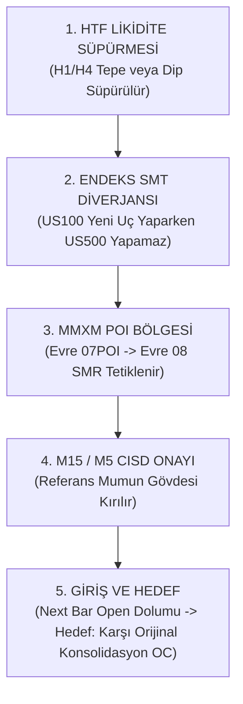

# ASTRA 6 — V3.4 NİHAİ İŞLEM OYNATMA KİTABI (EXECUTABLE TRADING PLAYBOOK)
**5 Boyutlu Fraktal Piyasa Anlatısı (QT × MMXM × CRT × SSMT × CISD) Doğrulanmış Kurumsal Uygulama Kılavuzu**

---

## 1. GİRİŞ VE METODOLOJİK İLKELER

Bu oynatma kitabı (Playbook), 5 yıllık (2021–2026) doğrulanmış piyasa verisi, 2.25 milyon atomik piyasa olayı ve 64 bağımsız faktöryel strateji politikası simülasyonundan elde edilen ampirik kanıtlar üzerine inşa edilmiştir.

### Altın Kurallar:
1. **Sıfır İndikatör Yanılsaması**: Hiçbir kural soyut indikatör çizgilerine dayanmaz; doğrudan mum fitilleri (likidite), mum gövdeleri (teslimat durumu - CISD), endeks korelasyon kopuklukları (SMT/SSMT) ve zaman pencerelerine (Quarterly Theory) dayanır.
2. **Önceden Var Olan Hedef Şartı**: Bir işleme girilmeden önce hedef seviye grafikte nesnel olarak mevcut olmak zorundadır. Sabit 2.0R hedefi piyasa yapısına aykırıdır; asimetrik yapısal hedefler (Original Consolidation, BSL/SSL) kullanılmalıdır.
3. **Doğrulama Gecikmesi Dengesi**: Bir faktörün onayını beklemek kaliteyi artırabilir ancak giriş fiyatını bozarak stop mesafesini genişletir. Giriş zamanlaması milisaniye ve bar hassasiyetiyle yönetilmelidir.

---

## 2. OYNATMA KİTABI 1: EN İYİ DOĞRULANMIŞ ALIŞ (LONG) OYNATMA KİTABI
**Model**: H1 Narrative → M5 Entry → M15 Liquidity Target (LONG)  
**Tarihsel Performans**: $N = 325$ İşlem | Kazanma Oranı: **%82.15** | Beklenti: **+0.8279R** | Profit Factor: **5.627** | OOS Beklenti: **+0.8956R**  
**İstatistiksel Statü**: `HISTORICAL_OOS_SUPPORTED` (Doğrulanmış ve OOS Destekli Alfa)

```
+----+--------------------------------+------------------------------------------------------------------------------------------+
| No | Parametre                      | Kural ve Uygulama Şartı                                                                  |
+----+--------------------------------+------------------------------------------------------------------------------------------+
| 01 | İzin Verilen Seans ve Zaman    | New York Sabah Seansı (09:30 – 11:30 NY) veya Londra Sabah Seansı (08:00 – 10:30 LDN)    |
| 02 | Yüksek Zaman Dilimi (HTF)      | H1 Grafiğinde Yükseliş Trendi (`bias_h1 == 1` ve H1 mumu gövde ile yukarıda)            |
| 03 | Likidite Hedefi                | Yakındaki M15 Alış Likiditesi (`M15_LIQ` = Önceki tamamlanmış 15-dakikalık bar tepesi)   |
| 04 | MMXM Zaman Dilimi ve Aşaması   | M5 veya H1 MMBM (Buy Model) Evre 04–06 (Yükseliş Genişleme ve Geri Çekilme)             |
| 05 | QT Döngüsel Zaman Bağlamı      | 90-Dakikalık QT Döngüsünde Q2 (Manipülasyon Sonu) veya Q3 (Genişleme Başlangıcı)         |
| 06 | Likidite Olayı                 | M5 grafiğinde önceki dip seviyesinin fitille süpürülüp reddedilmesi (`M5 Sweep/Reclaim`)  |
| 07 | SMT / SSMT Koşulu              | US100 yeni dip yaparken US500 veya US30'un bu dibi onaylamaması (Mikro SSMT Aktif)      |
| 08 | CRT Koşulu                     | M5 mumunun fitil süpürmesinden sonra seviye üzerinde kapanması (`Confirmed M5 CRT`)       |
| 09 | CISD Kuralı                    | 1-Dakika veya 5-Dakika grafiğinde son düşüş mumunun gövde ihlali ile kapanışı           |
| 10 | Giriş Tetikleyicisi ve Emir    | Onay mumu kapanır kapanmaz bir sonraki bar açılışında Piyasa Alış Emri (`Ask + Spread`)   |
| 11 | Yapısal Zarar Durdur (Stop)    | Süpürme hareketinin oluşturduğu yerel dip seviyesinin 0.15 × ATR altı (Min. 3.0 puan)    |
| 12 | Önceden Var Olan Hedef         | Giriş anından önce oluşmuş olan bir önceki M15 mumunun en yüksek seviyesi (`prev_h_m15`)  |
| 13 | Minimum Risk/Ödül Oranı (R:R)  | Hedef mesafesi en az 0.75R ile 1.50R arasında olmalıdır (Ortalama mesafe: 1.15R)         |
| 14 | Geçersizlik ve İptal Şartı     | CISD onayı gelmeden önce dip kırılırsa veya 15 bar (15 dk) içinde dolum olmazsa İPTAL    |
+----+--------------------------------+------------------------------------------------------------------------------------------+
```

---

## 3. OYNATMA KİTABI 2: EN İYİ DOĞRULANMIŞ SATIŞ (SHORT) OYNATMA KİTABI
**Model**: H1 Reversal → M5 Original Consolidation (OC) Target (SHORT)  
**Tarihsel Performans**: $N = 792$ İşlem | Kazanma Oranı: **%44.57** | Beklenti: **+0.1893R** | Profit Factor: **1.3424** | OOS Beklenti: **+0.2913R**  
**İstatistiksel Statü**: `HISTORICAL_OOS_SUPPORTED` (Doğrulanmış ve OOS Destekli Alfa)

```
+----+--------------------------------+------------------------------------------------------------------------------------------+
| No | Parametre                      | Kural ve Uygulama Şartı                                                                  |
+----+--------------------------------+------------------------------------------------------------------------------------------+
| 01 | İzin Verilen Seans ve Zaman    | New York Sabah Seansı (09:30 – 11:30 NY)                                                 |
| 02 | Yüksek Zaman Dilimi (HTF)      | H1 Grafiğinde Zirve Likiditesi Süpürülmüş (PDH veya H1 BSL Reddi)                        |
| 03 | Yapısal Model                  | H1 Tepe Dönüşü (Bearish Reversal / Smart Money Reversal)                                 |
| 04 | MMXM Zaman Dilimi ve Aşaması   | H1 veya M15 MMSM (Sell Model) Evre 08 (SMR) veya Evre 09 (Reversal Displacement)          |
| 05 | QT Döngüsel Zaman Bağlamı      | 90M QT Q3 (Kurumsal Dağıtım) veya 6H QT NY Açılış Manipülasyon Zirvesi                   |
| 06 | Likidite Olayı                 | Seans zirvesi veya H1 direncinin üzerine fitil atılıp içeri çekilme                      |
| 07 | SMT / SSMT Koşulu              | US100 yeni zirve yaparken US500'ün yeni zirve yapamaması (`Bearish Macro SSMT`)          |
| 08 | CRT Koşulu                     | H1 veya M15 mumunun fitil tepesinin altında kapanması (`Confirmed Bearish CRT`)          |
| 09 | CISD Kuralı                    | M15 grafiğinde son yükseliş mumunun en düşük seviyesinin altına gövde kapanışı           |
| 10 | Giriş Tetikleyicisi ve Emir    | M15 CISD barı kapanınca bir sonraki M1 bar açılışında Satış Emri (`Bid - Spread`)         |
| 11 | Yapısal Zarar Durdur (Stop)    | Reversal tepe noktasının 0.15 × ATR üzeri (Asla keyfi puan stopu değil)                  |
| 12 | Önceden Var Olan Hedef         | Döngünün başladığı M5 Orijinal Konsolidasyon seviyesi (`oc_target_m5`)                   |
| 13 | Minimum Risk/Ödül Oranı (R:R)  | Hedef mesafesi en az 1.50R olmalıdır (Ortalama gerçekleşen mesafe: 2.14R)                |
| 14 | Geçersizlik ve İptal Şartı     | M15 CISD kapanışından önce zirve aşılırsa veya 120 barda hedefe varılamazsa zamanaşımı  |
+----+--------------------------------+------------------------------------------------------------------------------------------+
```

---

## 4. OYNATMA KİTABI 3: DÖNÜŞ (REVERSAL) İŞLEM PROTOKOLÜ
**Hedef**: Trendin tükendiği likidite uçlarında kurumsal dönüşleri yakalamak.



### Dönüş Kuralları:
- **Asla Bıçak Tutma**: Fiyat sadece seviyeye değdi diye dönüş işlemi açılamaz (`LIMIT ORDER PROHIBITED`).
- **Gövde Kapanışı Şartı**: Fitil ihlalleri trend devamı olabilir; sadece mum gövdesi referans seviyenin gerisinde kapandığında (`Confirmed CRT`) dönüş kabul edilir.
- **Hedef Belirleme**: Dönüş işlemlerinde hedef her zaman hareketin doğduğu **Orijinal Konsolidasyon (OC)** tabanıdır.

---

## 5. OYNATMA KİTABI 4: TREND DEVAM (CONTINUATION) İŞLEM PROTOKOLÜ
**Hedef**: HTF trendi yönünde iç içe geçmiş (nested) düzeltme bitimlerinde trene binmek.

- **Bağlam**: W1 ve H4 trendi Alış (Bullish) yönündeyse, M15 grafiğindeki her geri çekilme bir Alış fırsatıdır.
- **MMXM Uyumu**: MMXM Evre 04 (Secondary Expansion) ve Evre 06 (Final Expansion) bacakları hedeflenir.
- **Giriş Zamanlaması**: Geri çekilme mumu M5'te tamamlanıp CRT verdiğinde, M1 CISD ile hızlı giriş yapılır.
- **Hedef**: Önceki günün en yükseği (PDH) veya H1 Buy-Side Liquidity (BSL) havuzu.

---

## 6. OYNATMA KİTABI 5: NASDAQ AÇILIŞ PROTOKOLÜ (NY OPEN 09:30–11:00)
**Konfigürasyon**: `CFG64_57` (CRT + Macro SSMT + Micro SSMT + MMXM)  
**Tarihsel Performans**: $N = 658$ İşlem | Win Rate: **%37.69** | Beklenti: **+0.0715R** (Shorts: **+0.1359R**) | PF: **1.1143**  
**İstatistiksel Statü**: `EXPLORATORY_POSITIVE`

```
+------------------------------------------------------------------------------------------------------------------------+
| NASDAQ AÇILIŞ DAKİKA DAKİKA EYLEM PLANI                                                                                |
+------------------------------------------------------------------------------------------------------------------------+
| 09:30 - 09:35 | KESİNLİKLE İŞLEM YAPILMAZ (NO TRADE ZONE).                                                             |
|               | İlk 5 dakikadaki spread açılması ve gürültü ham modellerde -0.3120R kayıp üretir. Likidite izlenir.   |
| 09:35 - 09:50 | Açılış Likidite Süpürmesi Beklenir (Opening Range High/Low Sweep). US100 vs US500 SMT aranır.          |
| 09:50 - 10:10 | ALTIN ZAMAN PENCERESİ: MMXM Evre 08 -> 09 dönüşü veya devamı M5 mum kapanışıyla teyit edilir.        |
|               | CFG64_57 şartları sağlandığında (CRT + SSMT) piyasa emriyle girilir.                                  |
| 10:10 - 11:00 | Pozisyon Yönetimi: Hedef 2R veya H1 likidite seviyesidir. 11:30'a kadar kapanmayan işlem MTM kapatılır.|
+------------------------------------------------------------------------------------------------------------------------+
```

---

## 7. KESİN İŞLEM YAPILMAYACAK DURUMLAR KONTROL LİSTESİ (STRICT NO-TRADE CHECKLIST)

Aşağıdaki durumlardan **HERHANGİ BİRİ** mevcutsa algoritmik motor ve manuel tüccar **İŞLEMİ DERHAL ENGELLEMELİDİR**:

1. **CISD Oluşmamış Durumlar (`00_No_CISD_Absent_Only`)**:
   Piyasada CISD yoksa işlem açmak %3.88 kazanma oranı ve **-0.9135R** felaket getiri üretir. Asla teslimat durumu değişmeden işlem açma!
2. **CFG64_17 Durumu (CRT ve CISD Olmayan Ham SSMT/MMXM)**:
   Beklenti **-0.4682R**, kazanma oranı %18.86'dır. Doğrulama filtresi içermeyen modeller doğrudan sermaye eritir.
3. **Açılışın İlk 5 Dakikası (09:30–09:35 NY)**:
   Filtresiz işlemler -0.3120R negatif kaymaya yol açar.
4. **Çelişkili Endeks Durumları (`07_Both_Conflicting`)**:
   US100 yeni zirve yaparken US500 ve US30 çelişkili ve karmaşık yön gösteriyorsa beklenti **-0.2987R**'dir.
5. **Gece Asya ve Düşük Hacimli Seanslar**:
   24 saatlik filtrelenmemiş evrende işlem açmak spread maliyetiyle -0.2918R negatif kayma yaratır. Sadece Londra ve NY seanslarında işlem yapılır.
6. **Yetersiz Risk/Ödül Oranı**:
   Hedef seviyeye olan uzaklık risk mesafesinin 0.75 katından azsa ($R:R < 0.75$) işlem pas geçilir.
7. **MMXM Tamamlanmış Aşama 13'te Doğrulamasız Ters İşlem**:
   Evre 13'te sadece QT Q2 içinde olduğu için körü körüne dönüş açmak **-0.1808R** kayba yol açar.

